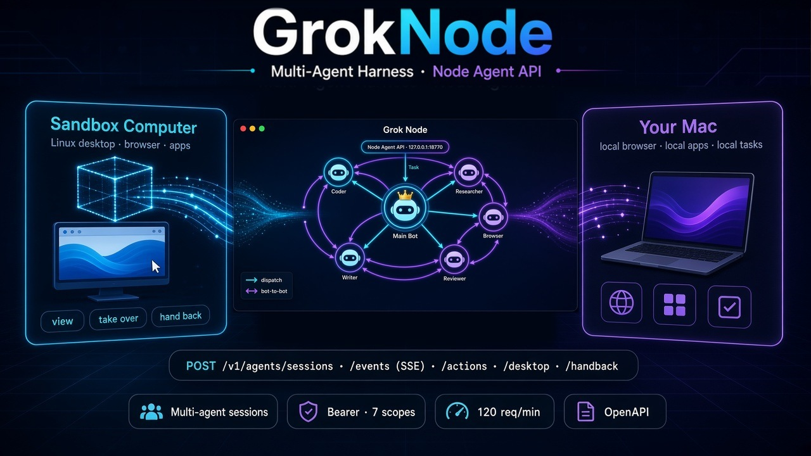
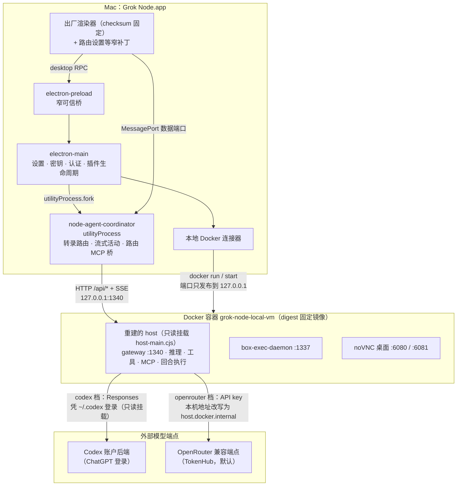
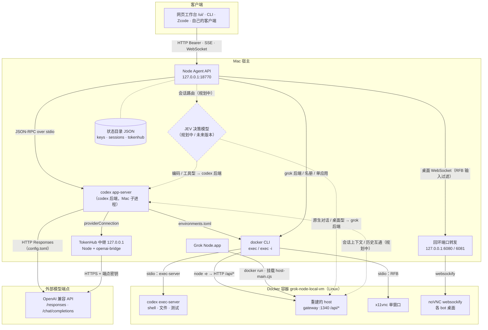
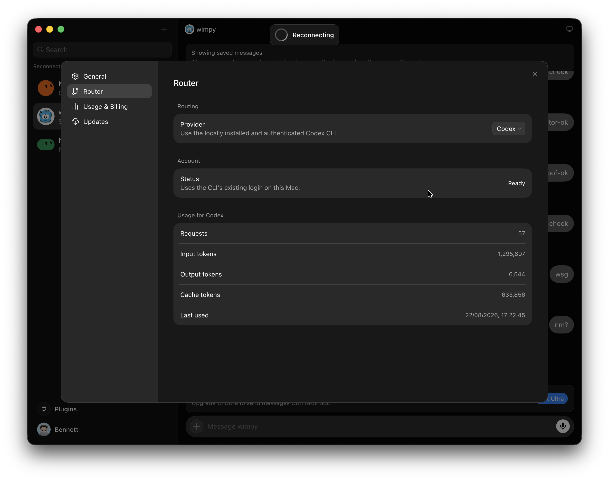
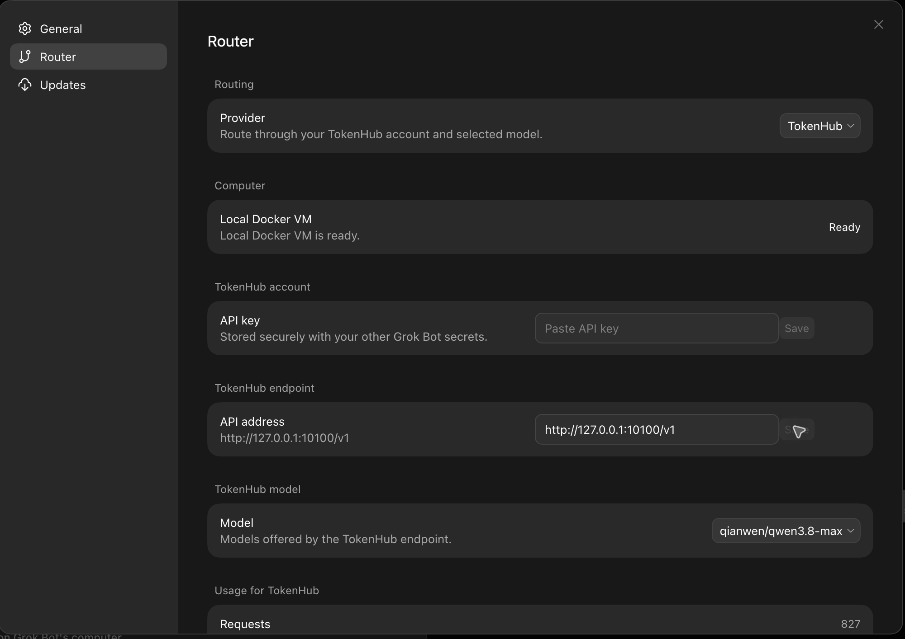
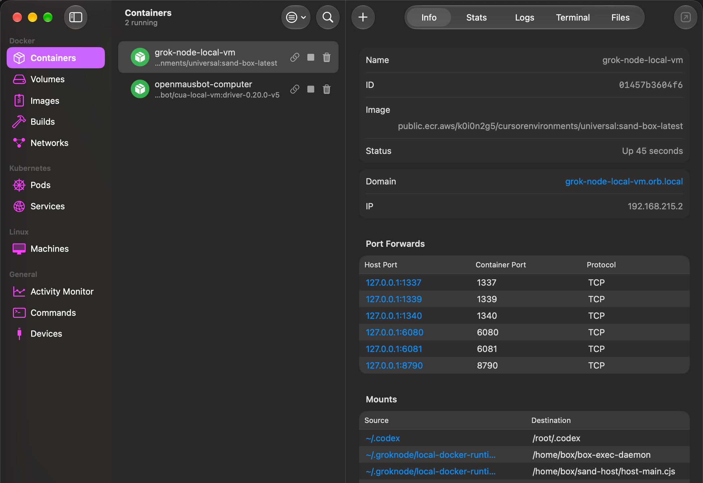

<h1 align="center"></h1>

<p align="center">
  
</p>

<p align="center">
  把公开发布的 Grok Bot 0.18.0 macOS 应用重建成可读 TypeScript，并把推理、沙箱、设置和用量统计都搬回你自己的 Mac。<br>
  另附一个本机 HTTP 服务 <strong>Node Agent API</strong>，让网页、CLI 或你自己的客户端调用这些 bot 和 Linux 桌面。
</p>

<p align="center">
  <a href="https://github.com/tyonger-stack/GrokNode/releases"></a>
  
  =26.5 <27" src="https://img.shields.io/badge/node-%3E%3D26.5%20%3C27-339933?logo=node.js&logoColor=white">
  
  
</p>

<p align="center">
  <a href="#快速开始"><strong>快速开始</strong></a> ·
  <a href="#node-agent-api-030"><strong>Node Agent API</strong></a> ·
  <a href="#多智能体-harness"><strong>多智能体 harness</strong></a> ·
  <a href="#架构"><strong>架构</strong></a> ·
  <a href="#排障"><strong>排障</strong></a>
</p>

> [!WARNING]
> 这是非官方的研究项目，与 Anysphere、Cursor、xAI、SpaceX 均无关联，也没有得到它们的认可。这里不是原始源码，也不是官方发布版本，并且不授予上游应用的任何许可。公开分发前请先读 [NOTICE.md](NOTICE.md) 和 [PROVENANCE.md](PROVENANCE.md)。

<table>
  <tr>
    <td width="50%" align="center" valign="top">
      <br>
      <sub><b>暗色主题</b> · 单独指定模型和推理强度 </sub>
    </td>
    <td width="50%" align="center" valign="top">
      <br>
      <sub><b>浅色主题</b> · 打开电脑和休眠</sub>
    </td>
  </tr>
</table>

<p align="center"><sub>界面支持暗色和浅色两种风格。</sub></p>

<details>
<summary><b>目录</b></summary>

- [它是什么](#它是什么)
- [功能一览](#功能一览)
  - [多智能体 harness](#多智能体-harness)
- [快速开始](#快速开始)
- [环境要求](#环境要求)
- [架构](#架构)
- [推理路由](#推理路由)
- [本地 Docker 沙箱](#本地-docker-沙箱)
- [Node Agent API 0.3.0](#node-agent-api-030)
- [运行身份与数据目录](#运行身份与数据目录)
- [环境变量](#环境变量)
- [开发命令](#开发命令)
- [仓库结构](#仓库结构)
- [测试与 CI](#测试与-ci)
- [排障](#排障)
- [项目状态与已知限制](#项目状态与已知限制)
- [溯源与安全](#溯源与安全)

</details>

## 它是什么

仓库包含两样东西：

| 组成 | 是什么 | 入口 |
| --- | --- | --- |
| **Grok Node.app** | 基于 Grok Bot 0.18.0 重建的 macOS 桌面应用。运行时由 `source/` 下的 TypeScript 编译，界面沿用经过 checksum 固定的出厂渲染器，并加上少量可审计的补丁。推理改走本机的 Codex 登录或 OpenRouter 兼容端点，代码执行放进应用自己管理的本地 Docker 容器。 | `npm run package` → `dist/Grok Node.app`，或下载 [Releases](https://github.com/tyonger-stack/GrokNode/releases) |
| **Node Agent API 0.3.0** | 独立的本机 HTTP 服务（默认 `127.0.0.1:18770`），自带网页工作台和 CLI。它把已经在运行的 Grok Node 里的 bot、Linux 桌面和项目操作开放成 API，**不包含在 ZIP 客户端里，也不会随客户端自动启动**。 | `npm run node-agent-api` |

名字里的 “Node” 指节点：原版应用依赖云端会话和远端沙箱，改造后它像一个自足的节点一样跑在本机。

## 功能一览

| 方面 | 能力 | 代码 / 文档 |
| --- | --- | --- |
| 推理路由 | 两档 provider：`codex`、`openrouter`（界面里显示为 TokenHub），默认 `openrouter` | `source/shared/inference-router.ts`、`source/shared/node/settings/sand-settings-store.ts` |
| 模型与推理强度 | TokenHub 档可以设默认模型；推理强度分 None / Low / Medium / High / Extra high / Max / Ultra；每个 bot 可以单独覆盖模型和推理强度 | `source/shared/node/openrouter-proxy.ts`、`scripts/lib/agent-model-renderer-patch.mjs` |
| 用量统计 | 按 provider 在本地累计请求数、输入/输出/缓存 token，并记录最近一次额度耗尽，数据不出本机 | `source/shared/inference-router.ts` |
| 本地沙箱 | 应用自己管理 `grok-node-local-vm` 容器。镜像按 digest 固定，端口只绑定回环地址；Shell、文件和 computer use 都在容器里执行 | `source/electron-main/box/local-docker-host-connector.ts` |
| 主 Bot | 移植了官方客户端的主 Bot 选择与替换 | `source/shared/node/grok-bot-main-agent.ts` |
| 插件 / MCP | 两档 provider 都保留 Grok Bot 工具和 MCP 工具执行；HTTP/SSE MCP 客户端在本地容器里运行 | [docs/LOCAL_HTTP_MCP.md](docs/LOCAL_HTTP_MCP.md) |
| 界面语言 | 内置 English / 简体中文 | `scripts/lib/language-renderer-patch.mjs` |
| 隐私边界 | 打包时禁用上游更新器，默认关闭 Sentry 和遥测 | `scripts/lib/build-asar.mjs`、[SECURITY.md](SECURITY.md) |
| Agent API | Bearer 鉴权、会话与 SSE、审批与取消、整桌面/单窗口观看与接管、项目导入导出与差异、备份、多用户配额、签名 webhook | [tools/node-agent-api/README.md](tools/node-agent-api/README.md) |

<!-- TODO(确认)：是否要在首页列出移植自更新版本官方客户端的界面（市场 0.66、聊天顶部身份条 0.61、webhook 例程 0.59 等，见 docs/ 下对应文档），以及它们是否都已进入最新 Release -->

### 多智能体 harness

Grok Node 里可以同时有多个 bot。它们能互相发消息、建群讨论、新建队友，也能派出子任务。Node Agent API 再把这些 bot 统一开放成 HTTP / SSE 接口，连到两边：沙箱电脑和你的 Mac。

**1. Grok Node 内部的多 bot 机制**（都在桌面应用里运行，以下名称都能在代码里找到）

| 机制 | 怎么用 |
| --- | --- |
| **bot 之间发消息** | bot 调用 `SendToAgent` 工具，按 id 发给另一个 bot 或自己所在的群聊，可附图片。消息是异步的：发出后立即返回，对方在新回合里被唤醒（提示前缀 `[agent]`），回复也按同样方式送回<br><sub>实现：`source/host/agents/agent-messaging.ts`、`source/host/runner/tools/sand-agent-management-tools.ts`</sub> |
| **新建 / 修改队友** | bot 调用 `CreateAgent` 新建 bot（返回 id，可以直接 `SendToAgent`），`UpdateAgent` 修改名字和描述<br><sub>实现：同上</sub> |
| **群聊** | 多个 bot 和用户在同一个房间里，按 @ 提及和轮次发言；群里只能放单个 bot，不能嵌套群<br><sub>实现：`source/host/groups/group-chat.ts`、`group-store.ts`</sub> |
| **群发** | 用户向全部或部分 bot 群发一条消息，收到的 bot 以 `[broadcast]` 唤醒<br><sub>实现：`source/host/host-gateway-api.ts`（`broadcastToAgents`）</sub> |
| **子任务** | bot 派出 `browserUse` / `computerUse` 类型的子 agent，再用 `CheckSubagent`、`MessageSubagent`、`StopSubagent` 跟进<br><sub>实现：`source/host/runner/subagent-runtime.ts`、`source/host/runner/tools/sand-*-subagent*.ts`</sub> |
| **主 Bot** | 指定一个 bot 为主 Bot（`getMainAgent` / `setMainAgent`）<br><sub>实现：`source/shared/node/grok-bot-main-agent.ts`、`source/host/host-gateway-api.ts`</sub> |

**2. Node Agent API 把 bot 接出来**

| 能力 | 接口与说明 |
| --- | --- |
| **列出 / 查看 bot** | `GET /v1/agents`、`GET /v1/agents/{agent_id}`<br><sub>实现：读取 Grok Node 的 bot 列表（gateway `listAgents`）</sub> |
| **新建 bot** | `POST /v1/agents`（字段 `name`、`description`；需要可访问全部 bot 的 key）<br><sub>实现：调用 Grok Node 的 `createAgent`（`tools/node-agent-api/cli.mjs`、`grok-node.mjs`）</sub> |
| **多会话并行** | `POST /v1/agents/sessions`：同一个 bot 可以开多个独立会话，各自有事件流、回合和审批<br><sub>实现：`tools/node-agent-api/server.mjs`、`codex.mjs`</sub> |
| **进入 bot 原生聊天** | 会话 `backend: "grok"` 时，消息直接送进该 bot 在 Grok Node 里的聊天（gateway `sendPrompt`）<br><sub>实现：`tools/node-agent-api/grok-node.mjs`</sub> |

Node Agent API 目前没有直接暴露 `SendToAgent`、群聊或群发的 HTTP 接口。bot 之间的通信发生在 Grok Node 内部；API 驱动的是单个 bot 和它的会话。

**3. 两条线：沙箱电脑和本地 Mac**

| | 沙箱电脑 | 本地 Mac |
| --- | --- | --- |
| 是什么 | 应用管理的 `grok-node-local-vm` 容器：Linux 桌面、浏览器、终端和应用 | 你自己的 Mac：浏览器、ZCode 和本地任务 |
| 怎么操作 | `GET/POST /v1/agents/sessions/{id}/applications`、`POST …/desktop`（观看 / 接管）、`POST …/handback`（交还）、`GET …/environment` | Codex Harness 的模型调用和工具循环在 Mac 上运行，命令和文件操作进入沙箱执行；bot 工具 `node_browser`、`node_zcode`、`node_ego` 操作 Mac 本机 |

<!-- TODO(定稿)：本地 Mac 这条线依赖的 node_browser / node_zcode / node_ego 目前只在维护者本机、尚未提交到仓库；待本地扩展提交后，再补实现文件、审批策略和用法，并定稿这一节。 -->


## 快速开始

### 方式一：下载预构建包（Apple Silicon）

1. 打开 [Releases](https://github.com/tyonger-stack/GrokNode/releases)，下载 `Grok-Node-<版本>-mac-arm64.zip`，然后核对哈希：

   ```sh
   shasum -a 256 Grok-Node-<版本>-mac-arm64.zip   # 和 Release 说明里的 ZIP SHA-256 比对
   ```

2. 解压后把 `Grok Node.app` 拖进 `/Applications`。
3. 这个包只做了 ad-hoc 签名，没有经过 Apple 公证。第一次启动时按 macOS 提示右键选「打开」。
4. 启动前先运行 Docker Desktop 或 OrbStack，再到 **设置 → 路由（Router）** 配置推理（见[推理路由](#推理路由)）。

> 应用底层版本始终显示 `0.18.0`，分发修订号以 GitHub tag（如 `v0.18.0-reconstructed.5`）和 ZIP 文件名为准。

### 方式二：从源码构建（macOS arm64）

```sh
git clone https://github.com/tyonger-stack/GrokNode.git
cd GrokNode
git lfs install
git lfs pull                 # 拉取固定的 0.18.0 DMG（约 156 MB）
npm ci
npm run bootstrap            # 校验 DMG 和 app.asar 的 SHA-256，抽取构建输入到 src/app/dist
npm run package              # 先跑 npm run check，再编译、打补丁、ad-hoc 签名、校验
open "dist/Grok Node.app"
```

- `npm run bootstrap` 依次尝试三个来源：本地缓存，LFS 归档（`research-archives/original/0.18.0/`），原始公开 URL（目前返回 HTTP 403）。也可以设置 `GROK_BOT_018_APP=/path/to/Grok Bot.app`，直接使用已有的应用副本。
- bootstrap 和打包要用到 `hdiutil`、`plutil` 和 codesign，**只能在 macOS 上运行**。Linux 上只能跑类型检查、测试和 `frontend:build`（见[测试与 CI](#测试与-ci)）。
- 本机已经安装的官方 Grok Bot 不会被覆盖。

### 方式三：运行 Node Agent API

前提：Grok Node 已经在运行，`grok-node-local-vm` 可用，Mac 和容器两端都装好了 Codex `0.160.0`，并准备好一个 OpenAI 兼容的模型 API（详见[环境要求](#环境要求)和[配置模型端点](#配置模型端点)）。

```sh
# 只需执行一次：在容器里安装 Linux 端 Codex 执行包
docker exec --user box grok-node-local-vm npm install -g @openai/codex@0.160.0 --prefix /home/box/sand-data/codex-vm

# 在仓库根目录
npm ci
export NODE_AGENT_BASE_URL='https://your-openai-compatible-api.example/v1'
export NODE_AGENT_API_KEY='...'      # 可选；密钥建议走环境变量，不要放在命令行
export NODE_AGENT_MODEL='YOUR_MODEL' # 可选
npm run node-agent-api -- --backend codex --port 18770 --recover true
```

启动后会输出一行 JSON，其中包括 `ui` 和 `owner_key_file`。打开 <http://127.0.0.1:18770/ui/>，把 `owner_key_file` 文件里的密钥（默认 `.lab/node-agent-shared/owner.key`，权限 0600）粘贴进网页。网页只在内存里保存密钥，刷新后需要重新输入。

<p align="center">
  <br>
  <sub>Node Agent API 网页工作台：左栏选 bot、会话和模型，中间看事件流并发消息，右栏观看 / 接管远程桌面和应用</sub>
</p>

## 环境要求

| 场景 | 要求 | 依据 |
| --- | --- | --- |
| 运行 Grok Node.app | Apple Silicon Mac；Docker Desktop、OrbStack 或兼容的本地 Docker 守护进程；Codex 登录或 OpenRouter 兼容端点的 API key | `local-docker-host-connector.ts` |
| 从源码构建 | 再加 Node.js `26.5.x`（`.node-version` 为 `26.5.0`，`engines` 要求 `>=26.5.0 <27`）、Xcode Command Line Tools、Git LFS | `package.json`、`.node-version` |
| Node Agent API | Node.js 26.5.x；Mac 端已登录 Codex（存在 `~/.codex/auth.json`），Mac 端 Codex CLI 必须正好是 `0.160.0`；容器内 `/home/box/sand-data/codex-vm/bin/codex` 也必须是 `0.160.0`（版本不符直接拒绝，不会自动升级）；一个 OpenAI 兼容的模型 API（地址、可选密钥、模型；配置方式见[配置模型端点](#配置模型端点)）。**不需要** Bun，也不需要 opencodex 或其他协议包 | `tools/node-agent-api/runtime/codex.mjs`、`inference-config.mjs`、`tokenhub.mjs`、`shared-runtime.mjs` |

> [!NOTE]
> 容器以 `--platform linux/amd64` 创建。在 Apple Silicon 上要靠 Docker/OrbStack 的 x86 模拟运行。<!-- TODO(确认)：是否需要用户手动开启 Rosetta 或其他设置 -->
>
> Agent API 写死了 `/usr/local/bin/docker` 作为 docker 路径（`tools/node-agent-api/shared-runtime.mjs`、`cli.mjs`）。如果你的 docker 只装在 `/opt/homebrew/bin`，需要建一个软链接。<!-- TODO(确认)：是否打算改成可配置 -->

<!-- 说明：Node Agent API 只需 OpenAI 兼容端点、不再依赖 Bun/opencodex，来自 #14（已合并）。 -->

## 架构

### 桌面应用



<!-- 依据：coordinator 只拦截 codex/openrouter 以外 provider 的 sendPrompt（source/node-agent-coordinator/inference-router.ts:226），这两档交给 gateway（main.ts:241-242），由容器内 host 的 provider-session.ts 发出请求；Codex 档读取 ~/.codex/auth.json（provider-session.ts:212-213），容器挂载见 local-docker-host-connector.ts:438；host.docker.internal 改写见 openrouter-proxy.ts:92；coordinator 是 utilityProcess（electron-main/coordinator/production-provider.ts:222），渲染器数据端口见 node-agent-coordinator/main.ts:244-245，gateway 调用见 gateway/gateway-client.ts:261。 -->

产物应用是混合式的：

- 应用运行时由 `source/` 下的可读源码编译而来；
- UI 基线沿用精修过的出厂渲染器，原始和打过补丁的渲染器分块哈希都会记录并接受校验；
- 少量确定性变换负责注入路由设置、每个 bot 的模型等界面（`scripts/lib/*-renderer-patch.mjs`）；
- 成品使用独立的 bundle identifier `com.anysphere.sand.reconstructed`，只做 ad-hoc 签名。

为什么保留出厂渲染器？分发包里没有前端源码和 source map，只有压缩过的生产分块。完整重写前端是一个大得多的独立逆向工程。`frontend/` 是一份部分重建的设计工作区，可以用来理解 UI 契约，但**它不是打包所用的渲染器**。

### Node Agent API：架构与运行边界

下面按源码画出 Agent API 的真实调用链。Agent API 和 Codex Harness 都跑在 Mac 上；它们进入容器只靠 `docker exec`，桌面画面走宿主机回环端口转发进来的 noVNC。两种会话后端都在图里：`codex`（独立 Codex Harness，默认）和 `grok`（直接进入 bot 原生聊天）。



> 图例：实线为已上线；虚线和虚框为规划中（未来版本）。

**调用链说明**（依据为 main 分支，未注明目录的文件都在 `tools/node-agent-api/` 下；模型端点部分来自已合并的 #14）

| 步骤 | 说明 | 依据 |
| --- | --- | --- |
| 1. 客户端 → API | 只监听 `127.0.0.1:18770`，校验 Host / Origin；REST 用 `Authorization: Bearer`，按 7 个 scope 授权；网页工作台由同一服务在 `/ui/` 提供 | `cli.mjs:19`、`server.mjs:75-86,274`、`auth.mjs:8,63-65` |
| 2. 事件流 | `GET …/events` 带 `Accept: text/event-stream` 时返回 SSE | `server.mjs:240-245` |
| 3. 选择后端 | 会话的 `backend` 为 `codex`（Harness 适配器，默认）或 `grok`（原生适配器）；`--backend codex` 时两个都装上 | `backends.mjs:5-15`、`server.mjs:159`、`cli.mjs:27-39` |
| 4. codex 后端 → app-server | 在 Mac 上启动 `codex app-server` 子进程，按行收发 JSON-RPC（`thread/start`、`turn/start` 等） | `runtime/harness.mjs:7,93,115-131` |
| 5. app-server → 容器执行端 | 生成 `environments.toml`，让 app-server 用 `docker exec -i … setpriv … codex exec-server --listen stdio` 进入容器执行工具 | `shared-runtime.mjs:173-176`、`runtime/codex.mjs:38-47` |
| 6. 模型请求 | 配了端点地址时，app-server 按 `config.toml` 里的 `openai_compat` provider 直连端点；未配置则不写 provider，也不连任何默认代理（#14） | `cli.mjs:25,36`、`inference-config.mjs:30-41`、`runtime/codex.mjs:27-31` |
| 7. TokenHub 中继 | 端点版本带密钥或用 Chat 协议时，会话带上 `providerConnection`，请求经本机中继转发到端点的 `/responses` 或 `/chat/completions`；中继用 Node 运行，Chat 协议由 `openai-bridge.mjs` 翻译（#14 起不再需要 bun / opencodex） | `codex.mjs:43-44`、`tokenhub.mjs:112,179-185`、`tokenhub-worker.mjs:6,39-45,62` |
| 8. grok 后端与 bot 名册 | `docker exec <容器> node -e …` 在容器里读 `/home/box/sand-data/gateway.json` 的 token，再 POST `http://127.0.0.1:1340/api/<方法>`；只允许 `listAgents`、`sendPrompt`、`getAgentTranscript`、`createAgent` 等 7 个方法。codex 后端也用这条通道查名册、建 bot | `grok-node.mjs:7-13,73,113-115`、`shared-runtime.mjs:23`、`cli.mjs:31-33` |
| 9. 整桌面画面 | `POST …/desktop` 签发一次性 ticket，兑换为 HttpOnly cookie；升级的 WebSocket 由 API 转连 `ws://127.0.0.1:6080/websockify`（或 `:6081?token=<display>`）。非控制者的键鼠消息被 RFB 过滤器丢弃；每个 bot 只有一个控制租约 | `desktop.mjs:36,80-84,98-138,184-247`、`grok-node.mjs:88-96`、`rfb-filter.mjs` |
| 10. 单应用画面 | 本机随机端口的 WebSocket 服务为每个窗口起 `docker exec -i node -e <application-stream>`，在容器里对该窗口启动 `x11vnc`，RFB 字节走 stdio | `shared-runtime.mjs:111-131,181`、`application-stream.mjs` |
| 11. 服务状态 | 密钥、会话、端点设置都存为 Mac 上的 JSON（默认 `.lab/node-agent-shared`，原子写入）；Codex 会话目录默认 `.lab/shared-runtime` | `auth.mjs:14`、`store.mjs:10`、`persistence.mjs:16-21`、`cli.mjs:22,29` |
| 12. Grok Node.app 与容器 | App 用 `docker run` 创建容器，只读挂载重建的 `host-main.cjs`，把 1337/1339/1340/6080/6081/8790 发布到 `127.0.0.1`。Agent API 不创建、不重启容器 | `source/electron-main/box/local-docker-host-connector.ts:464-482` |

#### 规划中

- **JEV 决策模型（会话路由）**：自动判断普通对话该交给哪个后端，编码 / 工具型任务进 Codex Harness 会话（`codex` 后端），原生对话 / 桌面型任务进 Grok Node 原生聊天（`grok` 后端）。未来版本上线，当前版本请在创建会话时用 `backend` 指定。
- **两类会话打通**：Codex Harness 会话与 Grok Node 原生聊天之间互通会话上下文和历史。未来版本上线，当前版本请在创建会话时用 `backend` 指定；两类会话的历史目前各自独立。

**各 bot 使用不同桌面，但共用容器和数据。** API 的用户/bot 权限只限制请求范围，不构成共享文件系统上 bot 之间的隔离。

## 推理路由

在 **设置 → 路由**（英文界面为 Settings → Router）选择新对话轮次使用的后端：

| Provider | 认证 | 说明 |
| --- | --- | --- |
| `codex` | 本机已有的 ChatGPT/Codex 登录（`~/.codex`，以只读方式挂进容器） | 不需要额外 API key |
| `openrouter`（UI：TokenHub） | 通过桌面密钥桥保存的 API key | **默认档**；可以选模型和推理强度 |

TokenHub 的 API 地址按以下顺序解析（`resolveOpenRouterBaseUrl`）：

1. 路由页 **API address** 中保存的值
2. 环境变量 `OPENROUTER_BASE_URL`
3. `~/.codex/config.toml`（或 `$CODEX_HOME/config.toml`）中的 `openai_base_url`
4. 默认 `https://openrouter.ai/api/v1`

如果填入的是本机地址（`127.0.0.1` / `localhost`），容器内的请求会改写到 `host.docker.internal`（`resolveOpenRouterTransport`）。

<table>
  <tr>
    <td width="50%" align="center" valign="top">
      <br>
      <sub><b>Codex</b> · 使用本机 Codex CLI 登录，并显示本地用量</sub>
    </td>
    <td width="50%" align="center" valign="top">
      <br>
      <sub><b>TokenHub</b> · Local Docker VM 状态、API key、API address 和模型</sub>
    </td>
  </tr>
</table>

路由页和 **用量与账单** 会显示本地累计的请求数和 token 数。这些只是活动记录，不能当作服务商的权威账单。

## 本地 Docker 沙箱

本地 Docker VM 是目前唯一的 box 运行时，也是默认值。应用在启动或切换时会做这些事：

- 检查 `docker info`。如果已经存在同名但不归本应用管理的容器（缺少 `com.grok-bot.local-vm=1` 标签），或者镜像不符，就报错并停止，不会替你删除；
- host bundle 的 sha 或 schema 版本变化时，自动替换容器。持久卷会保留，容器临时层里的改动会丢失；
- 等待 gateway 就绪，最多 3 分钟，然后校验实际提供服务的 host 身份。

| 项目 | 值 |
| --- | --- |
| 容器名 | `grok-node-local-vm`（打包后的 Grok Node.app）；开发运行时为 `grok-bot-local-vm` |
| 镜像 | `cursorenvironments/universal@sha256:8c489b5f…`（按 digest 固定，构建于 2026-10-21T01:03:42Z，完整地址见表下）。`:sand-box-latest` 标签只用来展示和兼容校验，**不要**换回这个会变动的标签 |
| 平台 | `linux/amd64`，`--restart unless-stopped` |
| 持久卷 | `<容器名>-workspace` → `/workspace`，`<容器名>-data` → `/home/box/sand-data` |
| 只读挂载 | 重建的 `host-main.cjs` → `/opt/sand/sand-host/host-main.cjs`、`box-exec-daemon` → `/opt/sand/box-exec-daemon`、`~/.codex` → `/root/.codex`（存在时）。挂载目标取自镜像自己的 host 目录（上游 2026-10-12 起改到 `/opt/sand/sand-host`，本项目已迁到该根），不是自选路径 |
| 上游自动更新 | 通过 `SAND_BOX_AUTO_UPDATE=0` 关闭，防止上游 host 覆盖重建版本 |

```text
public.ecr.aws/k0i0n2g5/cursorenvironments/universal@sha256:8c489b5f7f690b38acbf991e584a474bcc15cf81ebfe858c60235761191df1bd
```

端口全部只绑定 `127.0.0.1`：

| 端口 | 用途 |
| --- | --- |
| 1337 | box 执行守护进程 |
| 1339 | fork desktop router |
| 1340 | host gateway |
| 6080 | 主 noVNC 桌面 |
| 6081 | fork noVNC 桌面 |
| 8790 | egress 隧道 websocket |

<details>
<summary>截图：OrbStack 中的 <code>grok-node-local-vm</code> 容器（端口转发与挂载）</summary>
<br>
<p align="center">
  <br>
  <sub>容器名称、镜像、域名，六个只绑定 127.0.0.1 的端口转发，以及 ~/.codex 和重建 host 的挂载</sub>
</p>
</details>

## Node Agent API 0.3.0

Node Agent API 是 Grok Node 的外部适配 API，借鉴了 agents / sessions / events 的概念，**但不兼容 OpenAI Agents SDK**。后端实际支持哪些能力，以运行时 `GET /v1/capabilities` 的返回为准。

| 能力 | 接口 |
| --- | --- |
| 对话与任务 | bot 查询、会话、消息、SSE 事件、回合结果、审批、取消 |
| 会话执行方式 | `backend: "codex"`（独立 Codex Harness，默认）或 `backend: "grok"`（直接进入 Bot 原生聊天，用 Grok Node 自己的模型设置） |
| 模型与端点 | 获准模型清单、服务/bot 默认、TokenHub 地址/密钥/模型拉取与实际测试 |
| 桌面与单应用 | 整个桌面或单个终端/浏览器窗口的观看、接管与交还；手动传递剪贴板 |
| 项目与恢复 | 导入、Git 差异、归档导出、项目与会话备份/恢复 |
| 授权与治理 | Bearer 密钥、scope、派生 key、短期桌面 ticket、控制租约、配额、审计、签名 webhook |

启动参数（`tools/node-agent-api/cli.mjs`）：

| 参数 | 默认值 | 说明 |
| --- | --- | --- |
| `--backend codex\|grok` | `codex` | `grok` 单独启动时默认只读 |
| `--allow-writes true\|false` | `false` | 仅对 `--backend grok` 生效，允许发送原生消息 |
| `--port` | `18770` | 只监听 `127.0.0.1` |
| `--state` | `.lab/node-agent-shared` | 密钥、会话等服务状态 |
| `--runtime-state` | `.lab/shared-runtime` | Mac 端 Codex 会话目录 |
| `--container` | `grok-node-local-vm` | |
| `--workspace` | `/workspace/codex-projects/node-agent-api` | 容器内共享项目 |
| `--base-url` | 空（不连任何代理） | OpenAI 兼容端点地址，也可用 `NODE_AGENT_BASE_URL`，见[配置模型端点](#配置模型端点) |
| `--api-key` | 空 | 端点密钥；建议改用 `NODE_AGENT_API_KEY`，启动参数会出现在进程列表里 |
| `--wire-api chat\|responses` | 自动 | 端点协议，也可用 `NODE_AGENT_WIRE_API` |
| `--model` | 空 | 服务默认模型，也可用 `NODE_AGENT_MODEL`；为空时按模型策略决定 |
| `--namespace` | `grok-node-lab-shared` | |
| `--codex-bin` | — | 指定 Mac 端 codex 可执行文件 |
| `--recover true\|false` | — | 启动前恢复残留的服务锁 |

CLI（`npm run node-agent -- …` 等价于 `node tools/node-agent-api/client-cli.mjs …`）支持的子命令有 `ensure`、`status`、`desktop`、`codex`、`resume`、`backup`、`recreate`：

```sh
node tools/node-agent-api/client-cli.mjs status BOT_ID
node tools/node-agent-api/client-cli.mjs codex BOT_ID
node tools/node-agent-api/client-cli.mjs resume BOT_ID --thread THREAD_ID --prompt "运行测试"
node tools/node-agent-api/client-cli.mjs desktop BOT_ID --session API_SESSION_ID --mode view
```

### 配置模型端点

<!-- 说明：本节的配置方式来自 #14（已合并）。 -->

Agent API 只需要一个 OpenAI 兼容的模型 API，不需要 Bun，也不需要 opencodex 或其他协议包。**什么都不配时，端点地址为空，服务不会去连任何默认代理。**

**1. 启动时配置**（`tools/node-agent-api/inference-config.mjs`）。优先级：启动参数 → 环境变量 → 已保存的 `tokenhub.json`；空字符串视为未设置。

| 启动参数 | 环境变量 | 说明 |
| --- | --- | --- |
| `--base-url` | `NODE_AGENT_BASE_URL` | 端点根地址，例如 `https://example.com/v1` |
| `--api-key` | `NODE_AGENT_API_KEY` | 端点密钥；必须同时给地址。**建议用环境变量**，启动参数会出现在进程列表里 |
| `--model` | `NODE_AGENT_MODEL` | 服务默认模型 |
| `--wire-api` | `NODE_AGENT_WIRE_API` | `chat` 或 `responses` |
| — | `NODE_AGENT_MODELS` | 逗号分隔的模型 id，供没有 `/models` 的端点使用 |
| — | `NODE_AGENT_MODEL_CATALOG` | 旧式 slug 目录文件路径（可选） |

```sh
export NODE_AGENT_BASE_URL='https://example.com/v1'
export NODE_AGENT_API_KEY='...'
export NODE_AGENT_MODEL='YOUR_MODEL'
npm run node-agent-api -- --backend codex --port 18770 --recover true
```

没有指定协议时：

- 有密钥：按 Chat Completions。Mac 上的 Node 桥（`openai-bridge.mjs`、`tokenhub-worker.mjs`）把 Codex 发出的 Responses 请求翻译成 Chat，再把流式结果译回 Responses。密钥只留在 Mac，不写入 Codex 配置，也不进入 Linux 执行进程。
- 只有地址：按 Responses 直连，不启动桥。Codex 配置里的 provider 名是 `openai_compat`（`runtime/codex.mjs`）。把地址指向自己的本地 Responses 代理也可以，服务不会替你启动那个代理。

`tokenhub.json` 里已经有通过接口保存的端点版本时，启动参数不会改写它；还没保存过地址时，本次启动的值会写成初始版本。

**2. 运行中配置（TokenHub）**：owner 在网页“管理员模型设置 → TokenHub 账户与端点”里操作，或直接调接口：

| 步骤与接口 | 说明 |
| --- | --- |
| **设置端点**<br>`PATCH /v1/settings/tokenhub` | 字段 `base_url`、`api_key`（只写）、`wire_api`（`chat`/`responses`）、`models`（可选，模型 id 列表）。带了 `base_url` 但没带 `wire_api` 时默认 `chat`。地址必须是 HTTPS，或 `127.0.0.1`/`localhost` 的 HTTP。换地址会清除旧密钥。每次修改都会新建端点版本，已有会话继续用创建时的版本 |
| **拉取模型**<br>`POST /v1/settings/tokenhub/models` | 从 `{base_url}/models` 拉取模型列表 |
| **连接测试**<br>`POST /v1/settings/tokenhub/test` | body `model`、可选 `reasoning_effort`。真实调用一次端点，会消耗额度；测试通过后才能授权该模型 |
| **授权模型**<br>`PATCH /v1/settings/models` | 字段 `default_model`、`bot_defaults`、`allowed_models`、`verified_models`；把测试通过的模型加入获准清单 |

**模型目录**按顺序取：端点 `/models` 的结果 → `PATCH` 传入的 `models` 或 `NODE_AGENT_MODELS` → `NODE_AGENT_MODEL_CATALOG` 指向的目录文件。都没有时返回 `503 model_catalog_unavailable`，已有会话的模型不受影响（`models.mjs`）。

密钥用 AES-256-GCM 加密，保存在 `--state` 目录下的 `tokenhub.json`，加密密钥在同目录的 `tokenhub.master.key`（0600）。详见 [TokenHub 账户与端点](docs/NODE_AGENT_API_TOKENHUB.md)。

延伸文档：

- [Node Agent API 0.3.0 详细文档](docs/NODE_AGENT_API_0_3.md)：完整接口索引、请求示例、单应用 VNC、恢复与排障
- [安装与运行说明](tools/node-agent-api/README.md)
- [模型选择与默认设置](docs/NODE_AGENT_API_MODELS.md) · [TokenHub 账户与端点](docs/NODE_AGENT_API_TOKENHUB.md)
- [后台运行与排障](docs/NODE_AGENT_API_OPERATIONS.md) · [VNC 第一阶段](docs/NODE_AGENT_VNC_PHASE_ONE.md) · [性能](docs/NODE_AGENT_API_PERFORMANCE.md)
- [OpenAPI 3.0 契约](tools/node-agent-api/openapi.json) · [验证记录](tools/node-agent-api/VERIFICATION.md)

### 演示

#### ▶ 演示一 · Zcode 通过 Agent API 打开远程浏览器

在 Zcode 里输入“在远程电脑上的浏览器打开 baidu.com”，然后切到 Grok Node 查看同一个 bot 的桌面。<sub>（约 42 秒，中文字幕）</sub>

https://github.com/user-attachments/assets/3ad72f1d-1377-416f-95ce-2ff2b92166b2

#### ▶ 演示二 · Codex CLI 改代码并发布远程预览

把抽奖从「幸运三人组」改成「幸运六人组」，完成自检并发布到容器后，在远程浏览器里确认结果。<sub>（约 28 秒，中文字幕）</sub>

https://github.com/user-attachments/assets/5c794fb2-0429-45d6-95c8-a1ca0b97bca7

#### ▶ 演示三 · Zcode 增加 bot 功能（dots 样式）

在 Zcode 里给 bot 加上 dots 样式的桌面面板：缩略图观看、放大接管、再交还控制。

https://github.com/user-attachments/assets/5e1defe1-af18-4a59-85c5-c5f98488c09a

<!-- TODO(确认)：dots 演示中用到的接口是否都已在 GitHub main 上；本地有未提交的 Agent API 端点（desktop-screenshot 等）时，演示和代码可能对不上 -->

## 运行身份与数据目录

打包后的 `Grok Node.app` 使用下面这套独立身份，因此**可以与官方 Grok Bot 同时运行**；机器上已安装的官方应用也不会被覆盖。开发运行和测试仍沿用旧的共享身份。

| 项目 | Grok Node.app |
| --- | --- |
| Bundle ID | `com.anysphere.sand.reconstructed` |
| Electron 用户目录 | `~/Library/Application Support/Grok Node` |
| 数据根 | `~/.groknode` |
| Docker 容器 | `grok-node-local-vm` |
| URL scheme | `groknode`；本机没有安装官方 Grok Bot 时还会注册 `grokbot`（打包时由 `GROK_NODE_CLAIM_GROKBOT=auto\|always\|never` 控制） |

显式设置的 `SAND_DATA_ROOT` / `SAND_USER_DATA_DIR` 优先于以上默认值。

## 环境变量

只列出面向使用者或构建者的变量：

| 变量 | 作用 | 位置 |
| --- | --- | --- |
| `GROK_BOT_018_APP` | bootstrap 时直接使用已有的 Grok Bot 0.18.0 应用 | `scripts/bootstrap-runtime.mjs` |
| `GROK_BOT_OUTPUT_APP_NAME` | 自定义打包输出的应用名（默认 `Grok Node.app`） | `scripts/lib/config.mjs` |
| `GROK_NODE_CLAIM_GROKBOT` | `auto`/`always`/`never`，控制是否注册 `grokbot://` | `scripts/package-macos.mjs` |
| `OPENROUTER_BASE_URL` | TokenHub 端点的备选来源 | `source/shared/node/openrouter-proxy.ts` |
| `CODEX_HOME` | Codex 配置目录（默认 `~/.codex`） | 同上 |
| `SAND_DATA_ROOT` / `SAND_USER_DATA_DIR` | 覆盖数据根和 Electron 用户目录 | `source/shared/node/grok-node-identity.ts` |
| `SAND_DOCKER_BINARY` | 指定 docker 可执行文件（否则依次查找 `/usr/local/bin`、`/opt/homebrew/bin`、Docker.app 内置目录） | `local-docker-host-connector.ts` |
| `SAND_FIRST_TOKEN_STALL_DEADLINE_MS` | 首字停滞判定阈值（默认 150 秒） | [docs/OPENCODEX_CHANNEL_TROUBLESHOOTING.md](docs/OPENCODEX_CHANNEL_TROUBLESHOOTING.md) |
| `NODE_AGENT_BASE_URL` / `NODE_AGENT_API_KEY` / `NODE_AGENT_MODEL` / `NODE_AGENT_WIRE_API` / `NODE_AGENT_MODELS` / `NODE_AGENT_MODEL_CATALOG` | Node Agent API 的模型端点配置，见[配置模型端点](#配置模型端点) | `tools/node-agent-api/inference-config.mjs` |

<!-- TODO(确认)：SAND_DISABLE_UPDATES / SAND_DISABLE_SENTRY / SAND_DISABLE_TELEMETRY 是否算对外接口；如果是，补上取值语义 -->

## 开发命令

| 命令 | 作用 | 平台 |
| --- | --- | --- |
| `npm run bootstrap` | 校验并抽取固定的 0.18.0 构建输入 | macOS |
| `npm run check` | `typecheck` + `source:typecheck` + `test` | 任意 |
| `npm test` | 全部 `tests/*.test.mjs`（含真实网络测试） | 任意 |
| `npm run test:offline` | 排除真实网络测试（CI 使用） | 任意 |
| `npm run test:node-agent-api` | Agent API 离线回归 | 任意 |
| `npm run typecheck` / `npm run source:typecheck` | 渲染器 / 运行时 TypeScript 检查 | 任意 |
| `npm run frontend:build` | 构建可读的前端重建（不是打包所用渲染器） | 任意 |
| `npm run build` | 只构建重建 ASAR（`.build/app.asar`），不打包应用 | 需要先 bootstrap <!-- TODO(确认)：是否只能在 macOS 上运行 --> |
| `npm run package` | `check` 之后构建、打补丁、签名并校验 `dist/Grok Node.app` | macOS |
| `npm run verify` | 校验已打包的应用 | macOS |
| `npm run smoke` | 有时间上限的原生冒烟检查（退出码 0 通过 / 1 失败 / 2 前置条件不足） | macOS |
| `npm run diagnose` | OpenCodex 通道一键诊断（`-- --json` 输出 JSON；退出码 0/1/2 = OK/DEGRADED/DOWN） | macOS |
| `npm run box:seed-apps` | 把 `scripts/box-apps.d/*.sh` 的应用声明同步进容器 | macOS |
| `npm run publication:check` | 证明干净历史导出无损 | 任意 |
| `npm run node-agent-api` / `npm run node-agent` | 启动 Agent API / Agent CLI | macOS（需要 Grok Node 容器） |

`package:diagnostic`、`native:*`、`frontend:recover`、`marketplace:*` 用于取证和对拍，普通贡献者一般用不到。

生成目录 `.cache`、`.build`、`dist`、`src/app/dist`、`recovered`、`recovery`、`.lab` 等都不纳入版本控制。

## 仓库结构

```text
source/
  electron-main/           桌面生命周期、设置、认证、box 连接器、coordinator 所有权、RPC
  electron-preload/        暴露给 UI 的窄可信桥
  host/                    推理、工具、MCP、设置与回合执行（在容器内运行）
  node-agent-coordinator/  转录路由、流式活动、表情回应、路由 MCP 桥
  shared/                  共享契约、设置、协议与 provider 辅助
  box-exec-daemon/ local-exec-daemon/ packages/ ...
frontend/                  React/TypeScript 渲染器的部分重建与设计工作区
scripts/                   bootstrap、编译、渲染器补丁、打包、签名、校验
  box-apps.d/              容器内应用声明（每次启动重新应用）
tools/
  node-agent-api/          Node Agent API、网页工作台、CLI、OpenAPI
tests/                     node:test 回归测试
research-archives/         Git LFS 保存的固定 0.18.0 DMG 及清单
manifests/ patches/ docs/
```

## 测试与 CI

`.github/workflows/check.yml` 的内容：

- **ubuntu**：Node 26.5.0；`npm ci`；`typecheck`、`source:typecheck`、`test:offline`、`frontend:build`、`publication:check`。
- **macOS**：应用身份与 URL scheme 等依赖 macOS 的测试。
- **network**（手动触发）：真实网络的 web tools 测试。

在 Linux 上本地复现：

```sh
git lfs pull     # 否则固定安装包的清单测试会失败（134 !== 155793020）
npm ci
npm run typecheck && npm run source:typecheck && npm run test:offline && npm run frontend:build
```

## 排障

- 所有 bot 都不回复、回复中断、左下角出现状态灯：先运行 `npm run diagnose`，再看 [OpenCodex 通道故障排查](docs/OPENCODEX_CHANNEL_TROUBLESHOOTING.md)。
- 路由页 **Local Docker VM** 卡片显示 Unavailable：确认 Docker/OrbStack 在运行，并检查是否有同名但不归本应用管理的容器。
- Agent API 打不开或桌面连不上：见 [后台运行与排障](docs/NODE_AGENT_API_OPERATIONS.md)。

## 项目状态与已知限制

- 应用可以启动，核心本地化链路可用：路由推理、已连接插件、本地 Docker 沙箱。
- 只面向一个固定的 macOS/arm64 版本（0.18.0），不提供 Windows / Intel 包，也不承诺兼容未来的 Grok Bot 版本。
- 依赖外部 provider 会话；`npm audit` 仍有与固定 Electron 42.1、Undici 5、AI SDK 4 等相关的告警（见 [SECURITY.md](SECURITY.md)）。
- 镜像固定在 digest `8c489b5f…`（构建于 2026-10-21T01:03:42Z），in-box host bundle 根目录为 `/opt/sand/sand-host`：上游 2026-10-12 起把该根目录从 `/home/box/sand-host` 迁到 `/opt/sand/sand-host`，重建 host 必须挂到镜像自己的启动路径上才会被 supervisor 拉起（挂错位置 = 死文件 + 上游 host 顶替，重建功能静默失效）。切换镜像时，镜像 pin 与挂载根必须一起改。

## 溯源与安全

- 技术溯源与证据规则：[PROVENANCE.md](PROVENANCE.md)；法律声明：[NOTICE.md](NOTICE.md)；安全说明：[SECURITY.md](SECURITY.md)，请私下向仓库所有者报告问题。
- 固定构建输入：

  | 平台 | 字节数 | SHA-256 |
  | --- | ---: | --- |
  | macOS arm64 | 155,793,020 | `a253ccd8aab01e083f9812a0264354c5034d8ba7f0610bbb557e82ae77d203eb` |

  校验方法见 [research-archives/README.md](research-archives/README.md)。
- 贡献：先读 [CONTRIBUTING.md](CONTRIBUTING.md)；干净历史导出流程见 [docs/PUBLISHING.md](docs/PUBLISHING.md)。
