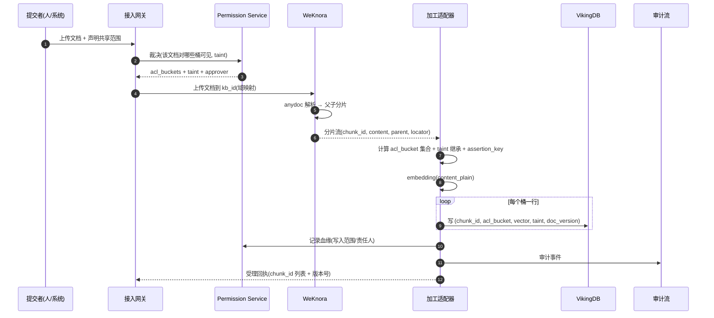
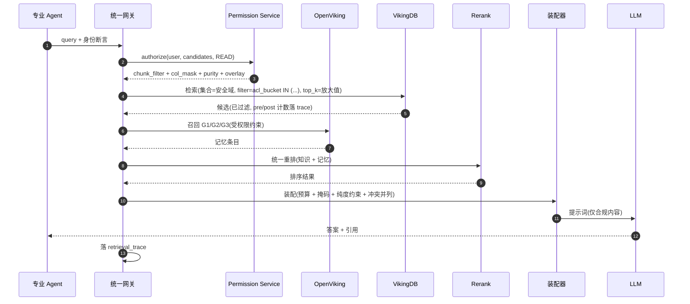
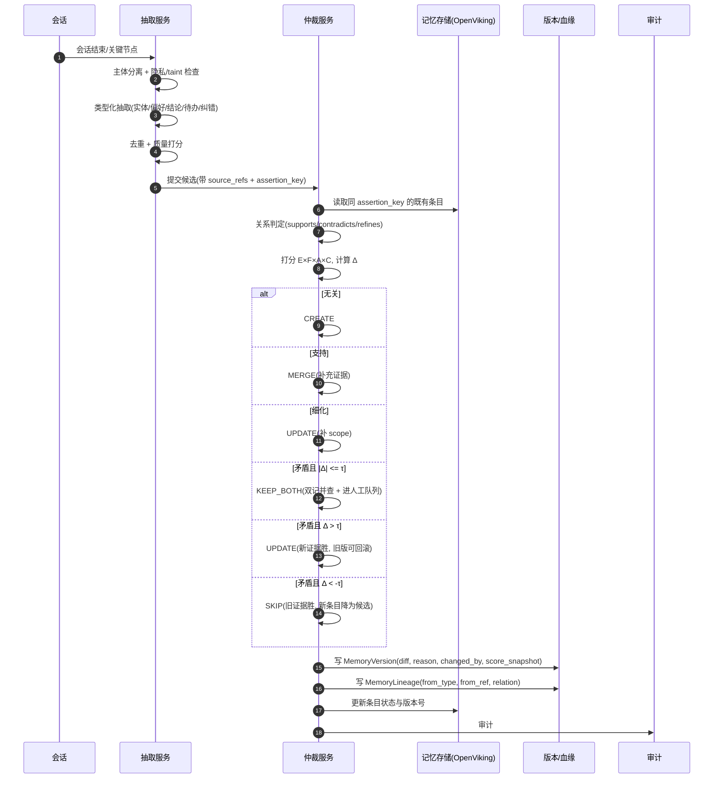
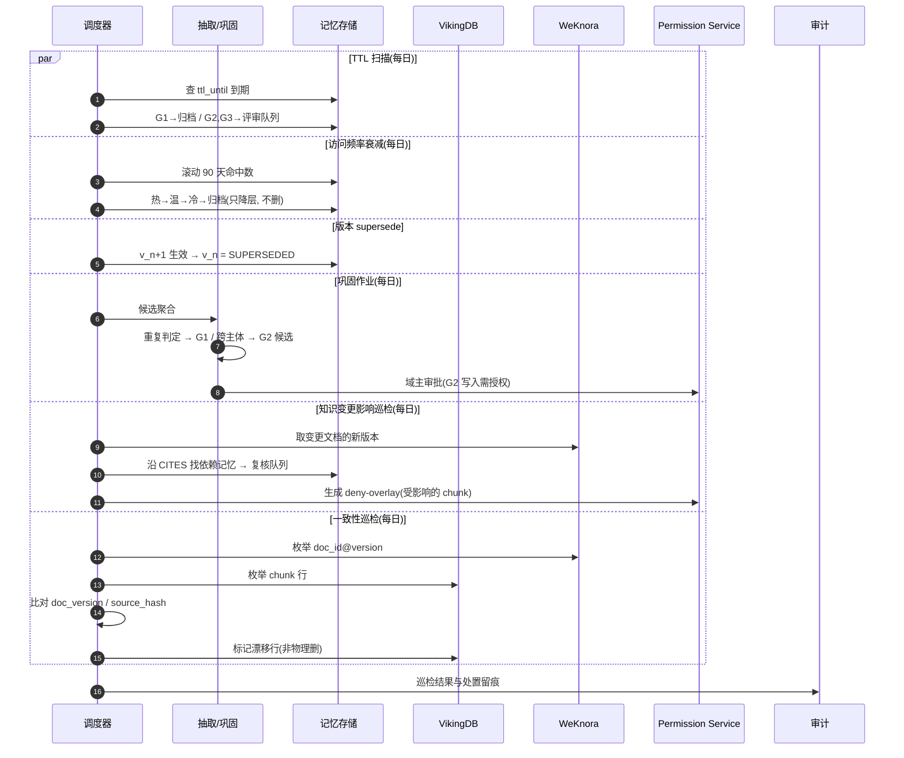

# 03 · 存储与检索层：VikingDB / OpenViking × WeKnora

> **本章结论**：三者**不是三个可替换的组件，而是三个不可互相替代的角色**——WeKnora 管「**文档→分片→Wiki**」（内容加工与版本快照），VikingDB 管「**分片→向量→检索**」（大规模向量召回 + 标量过滤下推 + 重排），OpenViking 管「**记忆与上下文的演进**」（AGFS 文件系统、会话提交、记忆提炼、变更回滚）；三者以**统一 Chunk Schema** 为唯一契约，以 `chunk_id` + 血缘关联，**内容只写一处**。

---

## 3.1 能力边界对照表

**结论**：判断一个能力该落在谁身上，看三个问题——**它是否需要原文与结构**、**它是否需要大规模近似召回**、**它是否需要读写与演进语义**。

| 能力 | WeKnora | VikingDB | OpenViking | 本方案归属 |
| --- | --- | --- | --- | --- |
| **文档解析** | ✅ anydoc：PDF/Word/Excel/PPT/Markdown/HTML/EPUB/MHTML/图片/CSV/JSON/XMind；支持 VLM/ASR；保留文件夹结构与元数据 [A] | ❌ | ⚠️ 资源接入后自动摘要/概览（非结构化解析） | **WeKnora** |
| **分片（Chunking）** | ✅ 关键词 + 稠密向量 + **父子分块**（parent-child）[A] | ❌ | ⚠️ 目录级 sidecar 摘要 | **WeKnora** |
| **分片可编辑 + 版本快照** | ✅ 检索分块可编辑并留存版本快照 [A] | ❌ | ✅ `memory_diff.json` 变更审计与回滚（针对记忆） | **WeKnora**（知识侧）/ **OpenViking**（记忆侧） |
| **知识库 / Wiki 管理** | ✅ FAQ + 文档两类知识库；**Wiki 模式**生成互链 Markdown 页 + 知识图谱；标签管理、在线编辑 [A] | ❌ | ❌ | **WeKnora** |
| **图谱增强（GraphRAG）** | ✅ 可扩展 [A] | ❌ | ❌ | **WeKnora**（图谱与实体抽取） |
| **向量索引** | ✅ 内置（Elasticsearch / 向量后端可配） | ✅ **原生，HNSW / IVFFLAT，单分片 ≤ 2000 万条 768 维，最大 4096 维** [A/B] | ✅ 内部向量索引（面向 AGFS 目录） | **VikingDB**（企业级规模检索） |
| **混合检索** | ✅ 关键词 + 向量 + 图谱 | ✅ **向量 + 标量**（另见官方对"全文+结构化"的表述）[A] | ✅ 两阶段：意图分析 + 层级检索 + Rerank [A] | **VikingDB**（召回）+ **OpenViking**（记忆域） |
| **标量过滤 / 权限下推** | ⚠️ 有知识库级权限（组织/租户/角色），**非索引级行过滤** [C] | ✅ **原生标量过滤**（包含/不包含/>/</≥/≤，AND/OR 组合）[A] | ⚠️ 目录作用域（路径级） | **VikingDB**（唯一行级下推点） |
| **SQL / 条件表达** | ✅ RESTful API | ✅ `SELECT ... WHERE ... ORDER BY dis ASC LIMIT n` [A] | ✅ CLI + SDK | **VikingDB** |
| **聚合统计** | ⚠️ | ✅ sum/avg/min/max、group_by 分桶、vector_weighted_sum [B] | ❌ | **VikingDB** |
| **记忆 / 上下文** | ⚠️ 0.8.0 新增跨会话长期记忆 + 文档自动标签 [B] | ❌（仅向量） | ✅ **核心能力**：Memory/Resource/Skill 三类、Session 提交自动提炼、MemoryType Schema [A] | **OpenViking** |
| **上下文注入（渐进式加载）** | ❌ | ❌ | ✅ **OV0 摘要 (~100 tok) / OV1 概览 (~2000 tok) / OV2 详情（原文）** 三档按需 [A] | **OpenViking** |
| **可观测性** | ✅ Web UI + API + CLI + Chrome Extension + 微信小程序 | ⚠️ 控制台 + SDK | ✅ `ov ls/tree/find/grep/status`、目录递归检索 [A] | 三者各自 |
| **Agent 集成** | ✅ ReAct Agent、MCP、Skill、**沙箱**（Docker/E2B/CubeSandbox，默认拒绝出网）[B] | ✅ SDK（Python/Go） | ✅ **MCP Server 模式**、Claude Code / Codex / Cursor / LangChain/LangGraph 集成 [B] | 中台封装统一 MCP 出口 |
| **部署形态** | ✅ 本地 / Docker Compose / K8s Helm，**全栈私有化** [A] | ☁️ **托管为主**（SLA ≥ 99.9%），SDK 开源（Apache-2.0）[A/B] | ✅ **自建**（Python Server + Rust AGFS 核心，进程内 binding）/ 火山托管 / Personal 版 [A] | 见 §3.4 |
| **License** | **MIT** [A] | 商业托管服务（SDK Apache-2.0）[A] | **AGPLv3**（`crates/ov_cli`、`examples` 为 Apache-2.0）[A] | 见 §3.4 |

### 3.1.1 三个"能力空白"必须由中台自补

**结论**：三者的能力表里有**三处明确的空白**，这些不能指望任何一方提供，必须由中台自建——否则整套方案会在实施期卡住。

| 空白 | 表现 | 中台自补方案 |
| --- | --- | --- |
| **跨系统统一授权裁决** | WeKnora 是"取低"组织 RBAC [C]；VikingDB 无授权语义；OpenViking 无企业 ACL | **Permission Service**（第 1 章）——唯一裁决源 |
| **记忆与知识的分层治理** | 三者都只提供"存取"，不提供"这条记忆属于哪层、谁能写、何时失效" | **记忆治理层**（第 2 章）：抽取/巩固/仲裁/淘汰/血缘 |
| **统一契约与防漂移** | 三方各有各的元数据模型，字段一多必然漂移 | **统一 Chunk Schema + 契约测试**（§3.2.2） |

---

## 3.2 分工原则与唯一契约

### 3.2.1 分工原则（一句话版）

| 职责 | 归属 | 为什么 |
| --- | --- | --- |
| **文档 → 分片** | **WeKnora** | 它有 anydoc 全格式解析、父子分块、分片可编辑 + 版本快照 [A]；这些是"内容加工"，不是"检索"问题 |
| **分片 → 向量 → 检索** | **VikingDB** | 原生标量过滤 + 索引级下推 + SQL + 聚合，是把 ACL 变成"召回前过滤"的唯一合适位置 [A] |
| **记忆与 `viking://` 上下文** | **OpenViking** | AGFS + Session 提交 + 记忆提炼 + `memory_diff.json` 回滚，是"记忆演进"的现成底座 [A] |
| **知识内容本体（唯一副本）** | **WeKnora 的知识库 / Wiki** | 中台以 `chunk_id` 引用，**不复制正文** |
| **向量**（可重建） | **VikingDB** | 可从内容重建，**不是权威副本** |
| **记忆正文** | **OpenViking** | G0–G3 记忆的实际存放处 |
| **权限元数据** | **Permission Service + Grant 表** | **不落在任何一方**，靠 Chunk Schema 里的标量列"物化"到 VikingDB 侧执行 |

> **"内容只写一处"的具体含义**：
> - 知识正文 → 只在 WeKnora；VikingDB 只存向量 + 元数据 + 必要的 `content_preview`（用于重排与片段展示，可裁剪）；
> - 记忆正文 → 只在 OpenViking；VikingDB 若需要记忆的向量索引，则**只存向量 + 记忆元数据**（`memory_id` + 版本 + 桶），正文按 `memory_id` 回源读；
> - Wiki 页 → 只在 WeKnora；OpenViking 的 `resources/` 可**引用**（`add_resource` 指向 WeKnora 导出的只读快照），但那是**衍生态**，权威副本仍在 WeKnora。

### 3.2.2 统一 Chunk Schema（唯一契约）

**结论**：`chunk_id` 是全局唯一主键，是三方之间**唯一的连接键**；Schema 变更必须走**契约测试**，任何一方不遵守即 fail（防漂移）。

```yaml
# ── 身份与血缘 ─────────────────────────────────────────────
chunk_id:        "ck_01J8Z..."        # ULID，全局唯一，三方共用
doc_id:          "doc_5a2f"            # 逻辑文档 id（WeKnora 知识库内文档）
doc_version:     7                    # 文档版本（WeKnora 版本快照号）
kb_id:           "kb_dom_qa"          # WeKnora 知识库 id
domain_id:       "domain:qa"          # 专业域（对应 Permission Service 的 DOM 主体）
parent_chunk_id: "ck_01J8Y..."        # 父子分片：指向父片（WeKnora 父子分块）
ordinal:         42                   # 文档内顺序
title_path:      ["工艺标准", "第4章 换型", "4.2 参数复位"]   # Wiki 层级路径

# ── 内容 ───────────────────────────────────────────────────
content_md:      "..."                # 权威正文只存 WeKnora；此处为检索用裁剪副本
content_plain:   "..."                # 纯文本（重排/BM25 用）
token_count:     318
lang:            "zh-CN"
content_type:    "text|table|image_caption|code|faq"
source_uri:      "https://.../工艺标准.pdf"
source_locator:  { page: 12, para: 3, bbox: null }   # 原文定位 → 引用核对
source_hash:     "sha256:..."         # 内容指纹，用于增量更新与一致性巡检

# ── 权限（物化到 VikingDB 的标量列） ───────────────────────
acl_bucket:      "domain:qa"          # 标量！桶化反范式，一行一桶
acl_deny_bucket: null                 # deny 不进索引（走 overlay），此列仅留档
security_domain: "kb_dom_qa"          # 物理隔离用的集合名
taint:           "T1"                 # T0..T4
scope_condition: "A类产线 / 换型场景 / 温度<200℃"   # 适用条件 → 断言键的作用域

# ── 断言键（知识与记忆共享的语义锚） ───────────────────────
assertion_key:   { subject: "换型参数复位", predicate: "必须执行", value: "true",
                   scope: "A类产线" }

# ── 向量 ───────────────────────────────────────────────────
embedding_model: "doubao-embedding-vision-v1"
embed_dim:       1024
embedded_at:     "2026-10-20T09:00:00Z"

# ── 治理 ───────────────────────────────────────────────────
status:          "ACTIVE"            # 同记忆状态机
created_by:      "user:1234"
created_at:      "2026-10-19T14:22:10Z"
updated_at:      "2026-10-19T14:22:10Z"
lineage_ref:     { source: "weknora:doc_5a2f@v7", derived_from: ["ck_parent_..."] }
```

**契约测试（必须实现，防漂移）**

| 测试 | 断言 |
| --- | --- |
| T1 Schema 完整性 | 三方读到的同一 `chunk_id`，必需字段集一致且非空 |
| T2 ACL 一致性 | WeKnora 侧的 ACL 视图与 VikingDB 侧 `acl_bucket` 行**集合相等** |
| T3 版本一致 | `doc_version` 与 WeKnora 当前版本一致；不一致 ⇒ 触发增量重嵌入 |
| T4 向量可重建 | 随机抽 1% chunk，用 `content_plain` 重算 embedding，与库中向量余弦相似度 > 0.999 |
| T5 幂等 | 同一 `source_hash` 重复写入不产生新 `chunk_id` |
| T6 引用可定位 | 抽样 chunk 的 `source_locator` 能定位回原文对应位置 |

### 3.2.3 "不这样做的替代方案及其代价"

| 决策 | 选择 | 替代方案 | 代价 |
| --- | --- | --- | --- |
| 内容唯一副本 | WeKnora 存正文，VikingDB 存向量 | 两边都存正文 | 更新/撤销要改两处；不同步即产生**越权副本**（撤权后老副本仍在） |
| ACL 物化 | 桶化标量 + 集合隔离 | 单行集合字段 | 数组"包含"语义无一手背书 ⇒ 可能**静默失效即越权** |
| 连接键 | 统一 `chunk_id` | 各用各的主键，做映射表 | 映射表本身成为不一致来源；跨系统追踪要维护 N×M 映射 |
| 契约 | Schema + 契约测试 | 口头约定 | 漂移一定发生，且漂移在**权限字段**上就是安全事故 |
| WeKnora 做加工 | 复用 anydoc | 自建解析 | 重复造轮子，且丢掉父子分片/版本快照/多格式覆盖 |
| VikingDB 做召回 | 原生标量过滤 | WeKnora 内检索后裁剪 | **事后修剪**反模式：top-k 被权限吃掉，召回质量断崖（§1.5.1） |

---

## 3.3 三条数据流

### 3.3.1 写入流（文档 → 知识可检索）

```
① 来源登记        →  中台登记来源（制度库/网盘/业务库/外部授权库），记录 source_uri、owner、授权范围与到期
② 接入 WeKnora   →  上传文档到对应知识库（kb_id ↔ domain_id 映射）
③ 解析 + 分片    →  WeKnora anydoc 解析 → 父子分片；分片带 metadata
④ 权限固化 ★     →  中台按 Permission Service 裁决结果，为每个 chunk 计算 acl_bucket 集合与 taint
                    ★ 关键：ACL 在此刻固化，不是检索时才算
                    ★ 切分阶段已做「敏感边界对齐」（A5）：敏感段单独成块、强制高 taint
⑤ 向量化         →  中台（或 WeKnora 导出）取分片 → embedding → 写 VikingDB
                    写 N 行（N = 桶数），共享同一 chunk_id 与向量（桶化反范式）
⑥ 血缘登记       →  写 lineage_ref（doc_version、parent_chunk_id、来源）
⑦ 一致性巡检     →  每日比对 WeKnora 版本 vs VikingDB 行的 doc_version / source_hash
```

**步骤 ④ 的实现要点**

| 要点 | 说明 |
| --- | --- |
| 裁决时机 | **写入时**裁决并固化为标量列。检索时**不再计算**授权（除了 overlay 的 deny 增量），否则无法做索引级下推 |
| **切分阶段先做敏感边界对齐（A5）** | WeKnora 分片输出后、中台固化 ACL 前，先跑**敏感段检测**（PII/金额/客户名单/合同条款/薪酬/密钥），命中段**强制切点、单独成块**、强制 `taint ≥ T3`、独立安全域；**引用该敏感段的邻近块 taint 至少 +1 级**（防上下文泄漏）。这一步不可省略——否则敏感内容必然已被切进"可读块"，事后掩码管不到 |
| 桶的展开 | 一个 chunk 的可见桶 = 其所属知识库的 ACL ∪ 逐 chunk 的额外 ACL（如"这份合同仅张三可见"） |
| 桶数控制 | 写 N 行 ⇒ 存储放大 N 倍。控制手段：**优先用粗桶**（部门/域），个人级桶要**例外审批**（因为它既放大存储又需要逐人指定）；并按 §1.5.1 的 **L-无过滤 / L-单桶 / L-桶化**三档按域选择 |
| taint 继承 | chunk 的 taint ≥ 源文档 taint；文档级 taint 由来源登记时声明 |
| 变更传播 | 源文档更新 → WeKnora 产生新版本 → 增量重算受影响 chunk 的 ACL 与向量 → **旧版本行打 tombstone + overlay deny**（不靠索引删除） |

### 3.3.2 检索流（查询 → 可用上下文）

```
① 身份断言        →  拿到 principal + EPS（闭包）+ 场景（系统/Agent/用途）
② 意图与查询规划  →  OpenViking 风格的两阶段：简单 query 直接 find()；复杂 query 走意图分析
                     ⚠️ 意图分析必须发生在权限裁决**之前或同阶段**，不得先召回再判断意图
③ 权限裁决        →  Permission Service.authorize() → {chunk_filter, col_mask, purity}
④ 知识召回        →  VikingDB：按安全域分发到不同集合 → 标量过滤（索引内）→ 向量 top-k
                     预放大 top_k（桶化去重会占位）
⑤ 记忆召回        →  OpenViking：G1（本人）/ G2（域内）/ G3（组织），同样带 ACL 解析
⑥ 重排            →  Rerank 模型对知识 + 记忆统一重排（记忆可给更高基础分，因其更贴近当前主体）
⑦ 上下文装配 ★    →  token 预算分配 + 列级掩码 + 主体纯度约束 + 冲突条目并列呈现
⑧ 生成与引用      →  LLM 生成；每条断言带引用定位；trace 落盘
```

**步骤 ⑦ 的 token 预算分配（首期建议，需按实测调）**

| 区块 | 预算占比 | 说明 |
| --- | --- | --- |
| 系统提示 + 工具定义 | 固定（不可压缩） | 随工具数量增长，需单独管控 |
| **记忆** | 10–15% | G1+G2+G3；**记忆优先于知识**（更贴近当前主体） |
| **知识** | 60–70% | 重排后的分片，按 `token_count` 装箱 |
| 历史对话 | 剩余 | 超出则滚动摘要（摘要本身可作为 G0 候选） |
| 预留 | 5–10% | 给模型生成与工具往返 |

**"记忆优先于知识"的取舍**：记忆更贴近当前主体上下文，但可信度低于知识。若用户投诉"模型胡编"，**先降记忆预算**而不是降知识预算——这是排障的第一个动作（可写进 runbook）。

### 3.3.3 记忆流（会话 → 记忆 → 进化 → 回流）

```
① 会话素材        →  G0 上下文（易失）
② 触发判定        →  会话结束 / 关键节点 / 显式提交 / 工具产出（分级，见 §2.3.a.1）
③ 抽取            →  主体分离 → 隐私/taint 检查 → 类型化抽取 → 去重 → 质量打分 → CANDIDATE
④ 冲突检测 + 仲裁  →  关系判定（supports/contradicts/refines）+ 打分 → 四选一决策
⑤ 版本 + 血缘落库  →  MemoryVersion（含 diff/reason/changed_by/score_snapshot）
                    MemoryLineage（来源会话/分片指针）
⑥ 巩固与泛化      →  G0→G1（重复 ≥2）→ G1→G2（跨主体 ≥2 + 域评审）→ G2→G3（治理委员会）
⑦ 晋升通道        →  记忆知识化：G2 成熟规律 → 治理审批 → 生成知识分片 → 走知识链路
⑧ 淘汰与回滚      →  TTL / supersede / 频率衰减降层 / 治理评审；回滚留痕
⑨ 指标反哺        →  6 指标 + 4 护栏 → 参数调节（人工审核后生效）
```

---

## 3.4 部署形态与 License 风险

### 3.4.1 三种路径对比

| 维度 | **路径 A：全托管** | **路径 B：混合（推荐起步）** | **路径 C：全自建** |
| --- | --- | --- | --- |
| VikingDB | 火山托管（VikingDB + 知识库 + 记忆库产品） | 火山托管 | Milvus / 自研 |
| OpenViking | 火山托管（OpenViking 中国区托管） | **自建**（AGPLv3） | 自建 |
| WeKnora | 自建（容器化） | 自建 | 自建 |
| 运维负担 | 最低 | 中 | 最高 |
| 数据出域 | 记忆与个人偏好出域 ⚠️ | 仅知识向量出域 | 不出域 |
| License 风险 | 最低（服务协议） | **AGPL 隔离部署**（需法务确认） | AGPL + 额外开源义务 |
| SLA | 托管 SLA ≥ 99.9% [B] | 知识部分托管 SLA，记忆部分自担 | 全自担 |
| 适合阶段 | 概念验证（P0） | **P1–P2 生产** | P3 规模化 / 强合规行业 |

**推荐：路径 B**——理由是**记忆是最敏感的数据**（个人偏好、对话内容、跨主体推断），而**知识向量相对可外置**。把 OpenViking 留在企业内网自建，把 WeKnora 也自建（MIT 无障碍），只把 VikingDB 托管出去（它的价值恰恰在于"免运维的分布式索引"，自建收益低而成本高）。

### 3.4.2 License 风险逐项分析

| 组件 | License | 商用风险 | 处置 |
| --- | --- | --- | --- |
| **WeKnora** | **MIT** [A] | 无（保留版权声明与许可文本即可） | ✅ 可自由闭源集成；注意**保留 LICENSE 与版权声明** |
| **VikingDB（服务端）** | 商业托管服务 | 需签服务协议；**存在供应商锁定** | 规避手段：客户端只用开源 SDK（`volcengine` Python SDK，Apache-2.0 [A]）+ 自建 Retrieval Port 抽象层（§3.2） |
| **OpenViking（主项目）** | **AGPLv3** [A] | ⚠️ **AGPL 第 13 条**：若修改程序并通过网络向用户提供服务，须向这些用户提供修改后的源码 | 见下 |
| **OpenViking `crates/ov_cli` / `examples`** | Apache-2.0 [A] | 低 | 可闭源使用，但**不能与主项目代码混编进同一二进制**（会污染整体许可） |

**AGPL 适用边界的三种情形（必须由法务书面确认，不可自行判断）**

| 情形 | 风险 | 建议 |
| --- | --- | --- |
| **独立进程自建，仅企业内部员工/内部 AI 系统访问** | 🟢 通常不触发"向公众提供网络服务" | 推荐路径；法务出具一页说明即可 |
| **修改 OpenViking 源码后，内部使用** | 🟡 修改版同样受 AGPL 约束，但不对外提供即不触发第 13 条 | 内部使用 OK；**修改点要留档**（哪些文件被改、为什么） |
| **对外提供服务**（客户 AI 平台、外部协作方经网络访问） | 🔴 可能触发第 13 条源码开放义务 | **两个选项**：① 用火山托管版（服务协议，非 AGPL）；② 保留自建但**不修改**源码 + 不对外提供该服务 |

> **务必避免的做法**：把 OpenViking 的核心（Rust AGFS 或 Python Server）**链接/内嵌进闭源的商业产品**并对外提供服务。这是最典型的 AGPL 违规场景。**若必须内嵌**，需改用 AGPL 兼容的商业许可（向火山引擎询价）或用 `ov_cli` 之外的方式自研。
>
> **官方文档与社区分析均把 License 列为 OpenViking 的首要注意点** [A/B]，且项目自述"仍处早期阶段" [A]——**生产接入前必须自建一轮小规模验证**，不要直接相信官方 Benchmark。

### 3.4.3 供应商锁定与退出路径

**结论**：必须显式设计**"三个月内能整体切换"**的退出路径；否则记忆数据会成为最难迁移的资产。

| 锁定点 | 缓解 | 退出成本估计 |
| --- | --- | --- |
| VikingDB 专有向量索引格式 | 向量可从 `content_plain` 重建（契约测试 T4 已验证） | 低（重跑 embedding 流程） |
| VikingDB 标量过滤语义 | 抽象成 Retrieval Port；过滤条件用**标准 SQL 子集**表达 | 低 |
| WeKnora 的分片结构 | 分片是标准 Markdown + 父子关系，导出即可 | 低–中（结构还原） |
| **OpenViking 的记忆格式与血缘** | 🔴 **最高风险**：AGFS 目录 + `memory_diff.json` + 记忆 Schema 是自有的 | **高** ⇒ 必须**每条记忆强制携带 `source_refs` 与标准化的 `MemoryVersion/MemoryLineage`**（§2.3.e），使记忆**可降级导出为标准 JSONL** |
| 治理流程与指标 | 纯内部资产 | 无 |

**强制要求**：每季度做一次**导出演练**——把 G1/G2/G3 全量导出为标准 JSONL（含 lineage、version、ACL 桶、taint），验证可读、可重建。**没有演练过的退出路径等于没有退出路径。**

---

## 3.5 关键流程时序（四条链路的等价表述）

> **本章约定**：§3.5 为四条关键链路的时序描述；其小节编号 3.5.1–3.5.5。

> **本章结论**：四条链路里，**权限固化发生在写入期、权限过滤发生在召回期、权限撤销发生在应用层 overlay**——三者时序不可颠倒；记忆链路里，**每一次写入都必须先过断言键关系判定再落版本与血缘**。

### 3.5.1 文档接入 → 解析 → 分片 → 向量化 → 入库



**关键断言**

| 断言 | 失败处理 |
| --- | --- |
| 权限固化发生在分片**之后、写入之前** | 拒绝写入（不允许"先写后补权限"） |
| `acl_bucket` 为空 ⇒ **拒绝写入**（默认拒绝） | 硬失败 |
| 分片数 × 桶数 > 阈值 ⇒ 提示桶过细 | 人工确认后可继续 |
| 写入后 60 秒内可用检索 | 超时告警（索引构建延迟） |

### 3.5.2 检索 → 权限过滤下推 → 重排 → 上下文注入



**关键断言**

| 断言 | 意义 |
| --- | --- |
| `post_filter_candidates ≥ top_k` | 若显著偏小 ⇒ 过滤未下推（反模式） |
| 注入内容中**无**被 deny 的 chunk | 用 overlay 命中数做交叉验证 |
| 注入的每条内容都有 `source_locator` 或标注"推断" | 无定位 ⇒ 不可注入 |
| 冲突条目**成对出现** | 单条出现 ⇒ 隐式仲裁，违规 |
| 装配后 token 数 ≤ 预算 | 超限 ⇒ 降记忆优先于降知识？**否**：超限先裁知识，记忆优先级更高但仍需留最小集（见下） |

> **token 超限的裁剪顺序（明确写死）**：① 裁低 taint 的知识 → ② 裁重复内容 → ③ 裁低相关度知识 → ④ 最后才裁记忆（保留 ≥ 1 条最高相关记忆），**且每次裁剪都记入 trace**（谁被裁了，因为什么）。理由：记忆是本方案的核心资产，但**记忆里的错误代价高于知识里的缺失**（知识缺失 = 少说一句，记忆错误 = 说错）。这条规则的**反直觉性**要写进 runbook。

### 3.5.3 记忆回写 → 冲突检测 → 合并仲裁 → 版本与血缘落库



**关键断言**

| 断言 | 违反后果 |
| --- | --- |
| 每次写入都有对应 `MemoryVersion` 且 `reason` 非空 | 无法回答"谁改的、为什么" |
| `contradicts` 关系下**不得**出现无版本覆盖的写 | 静默覆盖 = 丢失可回滚性 |
| 幂等键重复 ⇒ 不产生新版本 | 重投导致记忆膨胀 |
| `KEEP_BOTH` 的条目在注入时成对出现 | 隐式仲裁 |

### 3.5.4 失效淘汰：TTL / supersede 级联 / 冷访问归档 / 巩固作业 / 向量↔文档一致性巡检



**关键断言**

| 巡检项 | 判据 | 处置 |
| --- | --- | --- |
| 向量↔文档一致性 | `doc_version` 与 `source_hash` 相等 | 不等 ⇒ 重嵌入 + 旧行打标 + overlay deny |
| 孤儿向量 | VikingDB 中存在 WeKnora 已删除的 `chunk_id` | 打 tombstone + overlay deny（**不靠索引删除**，20s 延迟 [B]） |
| 孤儿知识 | WeKnora 中存在但无向量行的 chunk | 触发补写 |
| 记忆↔血缘完整性 | `MemoryLineage` 指向的来源存在 | 断裂 ⇒ 标记降级（可信度降权） |
| 保护名单执行 | 保护名单内条目未被 TTL/衰减淘汰 | 违反 ⇒ 告警 + 恢复 |
| 墓碑合规 | 墓碑无内容、无可还原哈希（个人类） | 违反 ⇒ 合规告警 |

---

### 3.5.5 关键流程的"不这样做的替代方案及其代价"

| 流程 | 决策 | 替代方案 | 代价 |
| --- | --- | --- | --- |
| 写入流 ④ | 写入期固化 ACL 标量 | 检索期实时计算 ACL | 无法做索引级下推 ⇒ 退化为事后修剪，召回质量断崖 + 性能差 3 倍以上 [B] |
| 写入流 ⑤ | 桶化反范式（1 行 1 桶） | 单行多值字段 | 多值"包含"语义无一手背书 ⇒ 可能静默失效即越权 |
| 检索流 ④ | 安全域分集合 + 集合内标量过滤 | 单集合 + 精细过滤 | 敏感域与普通域混池，逻辑过滤一旦失效即跨域泄漏 |
| 检索流 ⑦ | 记忆优先 + 冲突并列 | 知识优先 / 冲突只给高分 | 前者：答案更贴题但更易错；后者：隐性机器仲裁，用户无感知 |
| 记忆流 ④ | 断言键 + 打分 + 阈值 | 向量相似度判冲突 | 相似度会把"相关"误判为"冲突" ⇒ 大量假冲突，人工队列爆炸 |
| 记忆流 ⑥ | 跨主体复现 ≥ 2 才泛化 | 单次即泛化 | 单次泛化 = 把偶然当规律，全域污染且不可逆 |
| 淘汰 ④ | 频率衰减只降层 | 直接删除 | 一年一用的宝贵规则被删，**不可逆资产流失** |
| 一致性巡检 | 标记 + overlay deny | 直接物理删除行 | 索引删除有 20s 延迟 [B] ⇒ 删除期间仍可召回（越权残留） |

---

**下一章** → [04-风险取舍与度量.md](./04-风险取舍与度量.md)：性能 / 成本 / 一致性三维风险表与度量体系。
