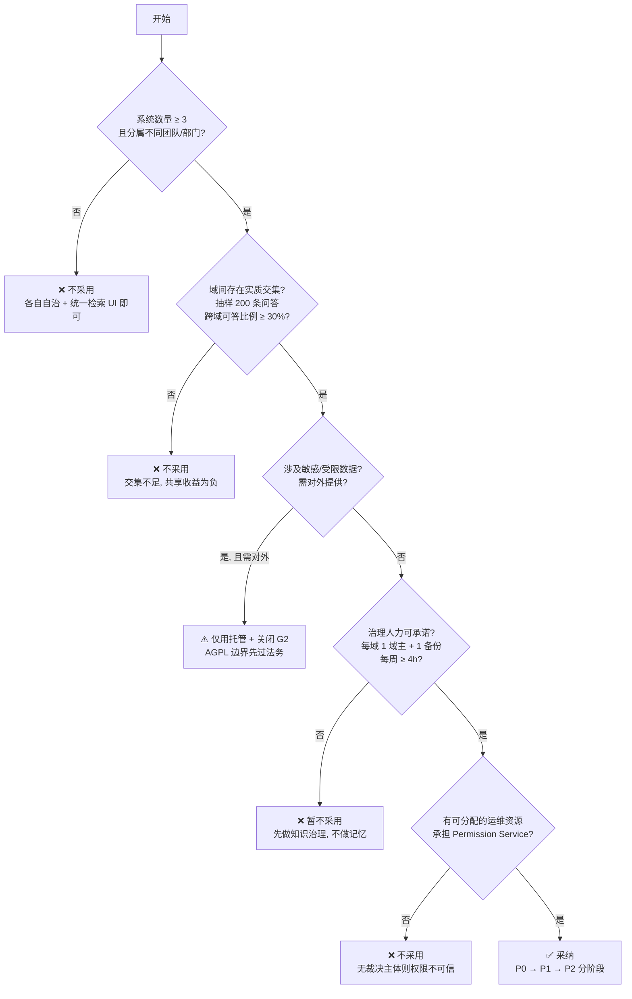

# 05 · 苏格拉底式反思（六维递进）

> **本章结论**：本方案在**权限正确性**上相对扎实，但在**共享的前提条件**上有一处未声明的脆弱假设——"多个专业 AI 系统面对的是同一个世界"。若不成立，G2 共享层会退化为噪声仓库；而这一缺陷**无法靠技术手段消除**，只能靠"语境契约"把不可通约的部分**显式地挡在共享边界之外**。以下 18 问逐层逼近，每问给出**可能触发的方案修正**；文末汇总本轮反思实际引发并已并入前四章的修订。

---

## 维度一 · 前提假设（这个方案成立，需要相信什么？）

### Q1. 「这些 AI 系统面对的是同一个世界」——若不成立，共享记忆是资产还是噪声？

**问题陈述**：多专业 AI 系统（算法诊断 / 质量检测 / 智能客服 / 研发助手）共享记忆的前提，是它们面对**同一个对象世界**、用**同一套术语**、且**结论可互相迁移**。若"良率下降"在质量域指产线指标、在算法域指模型指标；"异常"在客服域指客诉、在检测域指缺陷——那么 G2 共享层收集到的就是**同名异义的垃圾**，且因为它语义上"像知识"，会**比噪声更危险**（噪声被忽视，看起来像知识的噪声被采信）。

**分析要点**：
- 不可通约性有三种形态：**术语级**（同名异义）、**粒度级**（同一现象，不同抽象层）、**目的级**（同一数据，不同决策目标）；
- 本方案目前的防线只有"作用域吻合度 C"（§2.3.c.2 打分项），而 C 是**检索时**算的，不是**共享时**判的——共享时没有任何"这两个域的语境是否可通约"的检查；
- 后果不对称：在同构域（客服 ↔ 客服质检）共享，收益高、风险低；在异构域（工艺 ↔ 财务）共享，**收益需要额外证明，风险却是结构性的**；
- 关键判断：**不可通约不是技术问题，是组织问题**——两个域是否共用同一套主数据与业务对象，决定了共享是否有意义。

**可能触发的方案修正**：
1. **新增「语境契约（Context Contract）」**：G2 记忆条目**必须**声明 `premise_context`（前提语境：主数据域、术语基线、业务对象定义、决策目的），且**必须**通过**本体对齐检查**（与目标域的术语表/实体映射做校验）；不满足 ⇒ **拒绝进入 G2**，只能留在 G1。→ 需并入 §2.2.4、§2.3.b；
2. **默认只允许"同构域共享"**：跨域共享需**显式申请 + 治理审批 + 一次人工对齐评审**，且首批跨域共享条目数量限制（先 10 条，验证质量后再放开）；
3. **在 G2 目录结构上体现语境**：`viking://memories/<domain_id>/<ontology_id>/`，ontology 不同 ⇒ 物理分离，检索不跨 ontology。

---

### Q2. 四层（人/岗/团/部）是稳定的组织结构吗？矩阵与项目制下它如何失真？

**问题陈述**：本方案的继承链 `Org→Dept→Team→PositionAssignment→Person` 假设**层级组织是主要形态**。但知识型企业的真实形态往往是**项目制 + 矩阵制**：一个 30 人的算法团队同时服务 5 个业务线，每个业务线有自己的项目组、自己的临时权限、自己的"事实"。在这种组织里，"部门"只是**成本单元**，不是**知识边界**——而本方案把部门当成了**最高自然继承层**和**共享区的主要隔离单位**。

**分析要点**：
- 失真点 1：**成本单元 ≠ 知识边界**。算法部门与财务部门共享"产品线"知识，但部门割裂会阻断这条共享路径；
- 失真点 2：**项目是生命周期最短、权限变化最快的组织单元**。本方案对 `proj:` 主体强制 `end_at`，但只解决了"自动失效"，没解决"项目期间的多重授权叠加"——一个项目组成员同时带 3 个项目，EPS 闭包会迅速膨胀；
- 失真点 3：**外部协作方是"影子组织"**。供应商有自己的团队、自己的层级、自己的离职概念，而本方案只给它一个扁平的 `ext:` 桶——**合同到期 = 全部清零**，这在现实里过于粗暴（合同续期、条款变更、局部退出）；
- 失真点 4：**岗位在快速变化的知识组织里不稳定**。岗位名（"算法工程师"）不变，但岗位内涵三年一换代；`PositionAssignment` 绑定的是**编队**，编队重组会引发大规模 Membership 变更。

**可能触发的方案修正**：
1. **显式声明权限模型的表达能力边界**（写进架构文档首页）：本模型**适用于层级主导型组织**；在**项目制主导**的组织中，应把"项目"提升为**一等继承节点**，即继承链扩展为 `Org→Domain(业务域)→Dept ∥ Project→Team→PositionAssignment→Person`；
2. **`ext:` 主体从单桶升级为"外部组织 + 成员"两级**：`ext_org:<id>` + `ext_user:<id>`，合同变更时只影响对应层级，避免"到期全清"；
3. **部门作为隔离单位的降级**：**安全域（security_domain）的切分不再绑定部门**，改绑"**业务域 + 敏感度**"两个维度——这与 §3.1.1 能力表里"ACL 物化"和 §4.1 P7 的集合切分直接相关，**必须同步修改**；
4. **Membership 变更的影响面预估工具**：编队重组前先跑"若关闭某 assignment，EPS 收缩多少 / 多少 chunk 的可见性变化"，把权限变更当作**变更影响分析**来做，而不是直接执行。

---

### Q3. 「记忆能被可靠地抽取与概括」——这个前提在什么条件下不成立？

**问题陈述**：整个第 2 章建立在"LLM 能从会话里抽出稳定、可复用、主体正确的记忆"之上。但抽取质量高度依赖**会话质量**：如果用户的表达本身含糊、临时、玩笑式，或者会话里大量是无信息寒暄，抽取器要么产出噪声，要么什么都不产出。

**分析要点**：
- 最危险的不是"抽错"，而是**"抽得对但不该抽"**——把一句气话抽成"用户偏好"，且因为它重复出现而通过了巩固门槛（§2.3.b 的"重复 ≥ 2"），**错误被自动放大**；
- 巩固门槛"重复 ≥ 2"对**随机噪声**同样成立：一句气话在两个会话里出现两次，就能升级成 G1；
- 另一个隐患：**用户的错误认知会被系统固化**。用户反复说错一个参数，记忆系统会忠实地把它固化，并在后续所有回答中复现——而这恰恰是"记忆"相对于"知识"的危险之处（知识需审核，记忆不需要）。

**可能触发的方案修正**：
1. **巩固门槛加"跨会话 + 跨时间窗"要求**：G0→G1 不只看"重复 ≥ 2"，还要求**两次出现在不同日期的会话**（排除单次会话内的自我重复）；
2. **高风险类别单独设门槛**：偏好类、事实类（含具体数值/参数）的巩固门槛提高到 **≥ 3 次跨会话复现**，或**需 1 次显式确认**；
3. **引入"用户认知错误"标记**：抽取时若检测到用户表述与**知识库已有权威条目冲突**，该候选直接进**冲突队列**而不是巩固通道——**用知识纠正记忆的方向**（本方案原本只有"记忆→知识"单向，需补一条"知识→记忆"的**冲突检测**通道，但注意是"检测"不是"自动改写"）；
4. **抽取的"不确定即丢弃"默认**：抽取质量分低于阈值时**默认丢弃**而非默认保留（与常见做法相反，因为错误的记忆会长期存活，而丢失的候选可以重新抽）。

---

## 维度二 · 概念界定（这些词我定义清楚了吗？）

### Q4. 「知识 vs 记忆」的二分是充分的吗？Wiki 到底是什么？

**问题陈述**：本方案用"知识 = 外部权威可验证慢变"与"记忆 = 内部经验上下文相关快变"做二分。但**企业 Wiki 的实际形态**通常是第三种东西：它既不纯粹是权威知识（很多页面常年无人复核、含大量草稿与讨论），也不纯粹是记忆（有稳定结构、跨会话引用、被当作制度引用）。更麻烦的是 Wiki 页面上的**修订历史与讨论区**——那是典型的组织记忆（谁改的、为什么改、争论过程），而页面正文是知识。

**分析要点**：
- 纯二分不成立：存在"**知识化的记忆**"与"**记忆化的知识**"两个中间地带；
- "知识化的记忆"：一条被广泛引用、反复验证、写入制度后**仍然带着来源会话痕迹**的内容（例：一条来自事故复盘的规则，后来进了标准，但标准里仍引用"事故 #2317"）；
- "记忆化的知识"：一条本应是权威的制度，因组织变动而**实际上已失效，但因无人复核而仍在生效**（这是企业里最常见的知识腐化）；
- 本方案对此的应对目前只有一条 R-K 规则（"Wiki 页 = 知识，讨论区 = 记忆"），**过于简化**；
- 更深的问题：**"知识"与"记忆"其实是同一条内容在不同证据状态下的两种角色**，而不是两种内容类型。若这样看，分层（G0–G3）与知识域的关系应该是**正交**的，而不是并列的。

**可能触发的方案修正**：
1. **明确承认二分是工程近似，并给出"混合体"处理规则**：
   - 内容本体保留**一条**，但在元数据上同时打 `knowledge_view`（知识视图：给审核过的读者）与 `memory_view`（记忆视图：给检索/推理用的更完整版本，含讨论与修订线索）；
   - **一条内容一个 `chunk_id`，两个视图**——不复制内容，只复制**视图投影**（这与 §3.2.1 "内容只写一处"不矛盾，因为投影不是副本）；
2. **引入"知识新鲜度"字段** `knowledge_freshness`（`fresh` / `aging` / `stale` / `disputed`），由**引用频次 + 最近复核时间 + 是否被挑战过**自动推导；`stale`/`disputed` 的知识在注入时**显著降权并标注"可能已失效"**；
3. **知识腐化纳入巡检**：把"知识 stale 率"加入每日巡检指标（当前 §4.4 的一致性巡检只管"向量↔文档一致"，不管"知识是否已过时"）；
4. **修订历史作为一等公民**：Wiki 修订/讨论被建模为**挂在知识分片上的 G2 记忆**（而非丢弃），从而"谁在什么时候挑战了这条知识"成为可查的治理信号。

---

### Q5. 共享的最小粒度到底是什么？向量级、分片级、条目级各自的真实代价？

**问题陈述**：本方案主张"分片 + 记忆条目"是共享的最小可撤单元。但需要检验这个主张的每一层。

**分析要点**：
- **向量级不可行**：向量是语义的连续表示，无法从中"移除一部分"——两个分片即使内容独立，embedding 仍共享大量语义空间；**试图做向量级访问控制在数学上不成立**（ACL 必须作用在"载体"上，不能作用在"表示"上）。这是硬约束，不是工程难度；
- **分片级的真实问题不是"太粗"，而是"切分位置与敏感边界不对齐"**：一份文档里的敏感段落（客户名单、薪酬、合同金额）常常**夹在**无害段落之间。若切分按固定长度或按语义边界切，**敏感信息必然被切成"含敏感内容的块"**。本方案 §1.5.2 承认"掩码是第二道防线"，但**第一道防线（切分阶段的物理隔离）没有具体机制**——这是方案里**最实的一个洞**；
- **记忆条目级的真实问题**："一条记忆横跨多主体"不是罕见情况，而是**常态**（一次事故复盘涉及工艺、质量、供应商三方）。此时"条目级 ACL"退化为"条目内字段级 ACL"，而**字段级切分在自然语言里没有清晰的边界**（"供应商 A 提供了 200 吨次品，产线良率从 98% 降到 92%" 是一句话，无法按主体切成三段而不破坏语义）；
- 本方案 §1.5.2 用"主体纯度约束"处理这种情况（不可分割 ⇒ `not_injectable`，宁可不用）——**这个选择是保守正确的，但它意味着：横跨多主体的高价值记忆在多数情况下不可用**。这是**能力上的真实损失**，不应被轻描淡写。

**可能触发的方案修正**：
1. **切分阶段引入"敏感边界对齐"**：文档解析后先跑**敏感段检测**（PII / 金额 / 客户名单 / 合同条款 / 薪酬），命中段**单独成块**并强制 `taint ≥ T3` + 独立桶；普通块与敏感块**物理分离**，使"敏感块不可读"不依赖掩码；
2. **横跨多主体记忆的"可分割重写"**：不是拒绝注入，而是**为每个主体生成一个裁剪后的投影**（"对供应商 A 只保留'供应商 A 提供了次品'，其余移除"）——代价是**投影可能失真**。因此规定：投影必须**保留原始断言键与来源**，且**投影的置信度下调**（因为删减可能改变含义），注入时标注"（已按你的权限裁剪）"；
3. **不可分割时的降级阶梯**（而非一刀切拒绝）：① 尝试投影（带降权 + 标注）；② 失败则只注入**不含敏感实体的抽象结论**（"该批次存在供应商质量问题"而非具体数字与主体）；③ 仍失败才 `not_injectable`；
4. **明确写出这条能力损失**："横跨多主体且含具体数值的记忆，其完整形态对任一单主体都不可得"——**这是隐私保护的成本，应当被承认而不是隐藏**。

---

### Q6. 「失效」「淘汰」「被遗忘」是同一件事吗？

**问题陈述**：本方案在 §2.3.d 区分了 TTL、supersede、频率衰减、治理评审四种淘汰路径，在 §2.3.d.4 又区分了"删除 = 归档 + 墓碑"。但**"被遗忘权"（个人要求抹除）与"失效"（内容过时）在数据处理上完全相反**：前者要求**彻底清除**，后者要求**保留历史以备审计**。本方案在 §2.3.d.4 里说"被遗忘权：内容立即清除"，但**没有说清历史版本、备份、日志、向量副本、投影、副本分别怎么办**。

**分析要点**：
- 遗忘请求的真正覆盖面：**正文、全部历史版本、归档副本、向量（可从正文重建，但重建源已删则需删）、上下文投影、共享区副本、审计日志中的内容片段、缓存与备份**；
- 审计日志与遗忘权的**结构性冲突**：审计要"谁删了什么的痕迹"，而痕迹若包含内容则违反遗忘权。本方案的处理（只留哈希、随机 id）是合理的，但**对低熵内容连哈希都不保留**的规则必须落到**所有**派生面（向量也不能留——向量可被反演出内容！）；
- **向量与遗忘权**：embedding 不是"编码"，它是**内容的可逆近似**。只删原文留向量，等于没删——这是很多系统的盲区；
- 另一个被忽略的主体：**AI 系统自身形成的记忆**（"客服 Agent 记得张三偏好中文"）——其中一条其实来自张三。张三要求遗忘时，**这条系统记忆是否也要删**？本方案没有明确回答。

**可能触发的方案修正**：
1. **新增《遗忘请求处理清单》（Forget Manifest）**：显式枚举 9 类派生面（正文 / 历史版本 / 归档 / 向量 / 投影 / 共享区副本 / 引用（引用非复制 ⇒ 引用会自动失效，但要验证）/ 审计片段 / 缓存与备份），并为每一类定义处置（清除 / 降级为无内容元数据 / 保留）与时限；
2. **向量必须随正文一并删除或重建**（若无法定位正文则向量一并删）；
3. **明确"派生记忆的归属"规则**：由某人的信息派生出的、且**其价值主要来自该信息**的系统记忆 ⇒ 随遗忘请求清除；只保留**去标识化后的抽象规律**（"该类客户偏好中文沟通"而非"张三偏好中文"）；
4. **加入"遗忘请求演练"**：每季度随机选 1 条记忆走完整流程，验证 9 类派生面确实被清理（这是唯一能证明清单有效的办法）。

---

## 维度三 · 证据依据（我的结论有多少是被证明的？）

### Q7. 厂商自报的 "token 降 34–91%" 能支撑多大的架构决策？

**问题陈述**：本方案多处引用 OpenViking 的官方基准：LoCoMo 记忆回答准确率 24–57% → 80–83%、输入 Token 消耗降低 34.3–91.0%、查询延迟降低 58.45–66.10% [D 厂商数据]。这些数字**来自项目方自己的 benchmark、自己的测试集、自己的对照组**。社区转述与官方 README 的 tau2-bench 口径还存在互相不一致（"任务完成率 +43–49% / Token 成本 ↓83–96%" vs README 表述）——**连厂商自己的两个渠道都对不齐**。

**分析要点**：
- **证据等级**：这是 [D] 级——厂商自报、未经第三方复现、**基线由厂商选择**、测试集由厂商选择；
- **基线选择的杠杆最大**："相对原生记忆方案降低 34–91% token"中，**基线若选了一个极笨的实现，上限自然虚高**；三个 Agent 框架各自的原生记忆方案差异很大，选谁做对照直接决定数字；
- **这些数字不能支撑的决策**：不能支撑"因此我们必须用 OpenViking"（这是**选型**决策，需要的是可比的端到端成本，而非单一 benchmark 的相对值）；
- **这些数字能支撑的决策**：能支撑"**分层加载是有效方向**"这一**方向性**判断（多层结论互相印证：准确率上升同时 token 下降，这在机制上是自洽的）；
- 更该警惕的是**口径混用**：把"实验室基准的 token 降幅"当成"生产环境成本降幅"写进 ROI 测算。

**可能触发的方案修正**：
1. **建立"证据等级标注"强制规范**（已在 README §1 落地）：任何数字必须带 `[A]/[B]/[C]/[D]` 等级 + 出处 URL；**没有出处的数字不得进入决策文档**；
2. **ROI 测算改用自测数据**：P0 阶段必须产出**本企业自己的**对照（同一批真实问题，有/无记忆层两种配置下的 token、延迟、答案正确率），用**自己的**数字做决策，而不是引用官方；
3. **明确"选型依据 ≠ benchmark 依据"**：选 VikingDB/OpenViking/WeKnora 的依据应是**能力匹配（§3.1 表）+ License + 运维 + 退出成本**，benchmark 只作参考；
4. **对被引用口径不一致的 tau2-bench 数字，直接不引用**（只引用仓库 `benchmark/` 可复现的部分）。

---

### Q8. 我的"权限下推"设计凭什么被证明是正确执行的？

**问题陈述**：本方案的核心正确性主张是"权限过滤发生在索引内、不是召回后裁剪"，并且给了可证伪的判据（`post_filter_candidates ≥ top_k`）。但这个判据本身有**漏洞**：如果实现者错误地在**召回后**过滤，那么 `post_filter` 数字必然小于 `top_k`，会被抓到——**可如果实现者同时把 `top_k` 调大来"凑"这个指标呢**？

**分析要点**：
- 指标可被"优化"而非被"满足"——这是所有埋点式断言的通病；
- 更根本的：**没有独立于实现的黑盒验证**。方案里没有一个"用外部探针去攻击过滤逻辑"的机制；
- 还有一个盲区：**过滤下推只验证了"过滤发生的位置"，没验证"过滤条件是否完整"**——如果 ACL 集合算漏了（比如漏算了 `proj:` 桶），过滤下推率 100% 但越权照样发生；
- 换句话说：**"下推率"是过程指标，"越权召回数"才是结果指标**。方案里两者都有，但**结果指标的采集依赖红队主动攻击**，属于"没出事不等于没问题"。

**可能触发的方案修正**：
1. **引入黑盒探针（Probe）**：独立的验证服务，用**随机生成的、真实存在的 principal** 对随机 chunk 发起检索，比对"应可见集合"与"实可见集合"——**差集必须为空**。这是把正确性从"埋点自证"提升到"外部可证伪"；
2. **ACL 集合完备性校验**：每次裁决后，断言"返回的桶集合 ⊇ 该主体在资源上应得的所有桶"（用独立的 ACL 计算器复算一遍，两个实现互相验证）；
3. **"不适用"要说清**：越权召回数 = 0 这个指标，**在没有持续红队流量的情况下没有意义**——因此把"红队流量覆盖率"本身作为指标（被测 principal 组合数 / 应测组合数）；
4. **禁止用 `top_k` 放大来满足下推率**：下推率的判定改为 `post_filter / pre_filter` 的**量级关系 + 有效不同 chunk 数**，而非与 `top_k` 直接比较。

---

### Q9. 本方案自身的哪些结论其实是推测？

**问题陈述**：诚实盘点：哪些部分有实证支撑，哪些是我的推理。

**分析要点**（诚实清单）：

| 结论 | 证据等级 | 说明 |
| --- | --- | --- |
| VikingDB 支持标量过滤与索引级下推 | **[A]** | 官方文档明确 |
| VikingDB 索引更新约 20 秒 | [B] | 官方运营文章口径；**建议在 P0 实测确认**（这是撤权设计的支点，值得单独花时间验证） |
| WeKnora 权限是 `min(...)` 取低语义 | **[C]** | 第三方源码分析；**P0 阶段必须以仓库源码复核**——这是"不把 WeKnora 当裁决源"这个核心决策的直接依据 |
| WeKnora MIT / OpenViking AGPLv3 | **[A]** | 仓库 LICENSE |
| OpenViking 的 AGFS / L0-L2 加载 / session commit / memory_diff 回滚 | [A]/[B] | 官方文档 + 社区分析；**建议 P0 直接拉仓库跑一遍** |
| 桶化反范式下 top-k 被占位、有效召回率降至约 20% | **推测** | 基于"同一 chunk 写 N 行"的直接推理；**应实测标定** |
| 20–30% 有效召回率（事后裁剪） | **推测** | 同上 |
| 抽取 LLM 成本占比 | **推测** | 未实测 |
| 治理工时是最大隐性成本 | **推测（但有强直觉支撑）** | 来自同类系统经验，**本企业无数据** |
| G2 → G3 晋升率"每域每半年 ≥ 1" | **任意设定** | 属目标值，非预测；须在 P2 后按实测校准 |
| "记忆优先于知识"的裁剪顺序 | **判断，非数据** | 依据是"记忆错误代价 > 知识缺失代价"的推理；应在 P0/P1 用 A/B 验证 |

**可能触发的方案修正**：
1. **给上述清单建一个「待验证假设登记表」**：每条含**验证方法、验证时点、影响的设计决策**；P0 阶段的**首要任务就是验证支点级假设**（20 秒延迟、WeKnora 取低语义、桶化占位比例）——因为**如果这三条错了，方案的核心机制要改**；
2. **在架构文档中显式标注"哪些部分尚属设计假设"**，避免后续读者把推测当既成事实；
3. **禁止用"推测值"做容量与预算测算**（预算用最坏情况 + 实测修正）。

---

## 维度四 · 对立观点（最强的反对意见是什么？）

### Q10. 反方：「不要建中台，让各 AI 系统自治」

**问题陈述**：一个完全合理的反对意见——每个专业系统自带知识库与记忆，域内自治，跨域只通过人（邮件/IM/会议）传递。成本低、可控、没有治理负担、不会因为"共享了错误的记忆"而污染彼此。**为什么这个方案要否定它？**

**分析要点**：
- 反方**是对的**，而且在很多场景下**更优**：系统数量 ≤ 2、域间交集小、领域差异大时，中台的复杂度收益为负；
- 反方赢在三点：① **无治理成本**；② **无泄漏面**（不共享就没有共享泄漏）；③ **责任清晰**（域内自治 ⇒ 域主对内容负责）；
- 反方输在三点：① **重复劳动**（同一份制度被 N 个系统各解析一遍、各自维护）；② **知识不跨域**（跨域经验无法迁移，而这正是"多专业 AI 系统共享知识"的题眼）；③ **人成为瓶颈**（跨域信息靠人转述，转述即失真、且无版本）；
- 关键区分：**「自治」与「联邦」的差别不在技术，在"是否共享同一份权威副本 + 是否有受控的跨域通道"**。中台不必然带来"所有内容混在一起"——本方案的设计（隔离区/共享区 + 发布审核订阅）恰恰是为了**不混在一起**；
- 真正该承认的是：**本方案的成本只有在"域数量 ≥ 3 且域间有实质交集"时才划算**。

**可能触发的方案修正**：
1. **把决策门明确化**：**域数 ≤ 2 且交集 < 20% ⇒ 明确不建议采用本方案**，走自治 + 人工同步；
2. **P0 阶段必须量化"共享价值"**：统计各域的问答中"本应由他域知识回答"的比例（用一次人工标注，抽样 200 条即可），**低于阈值直接终止 P0**；
3. **保留"轻量联邦"选项**：域内自治保留全部能力，只把"**跨域共享的那一小部分**"通过共享区发布机制打通——**这本来就是本方案的设计**（共享区 = 显式的跨域通道），不需要全量中台化；
4. **在架构文档中把反方观点作为正式选项列出**，而不是隐含假设"中台一定对"。

---

### Q11. 反方：「记忆只该服务个体，跨系统共享只做知识就行」

**问题陈述**：另一个强反方——**记忆的本质是个人的**。跨系统共享"经验/偏好/结论"本身就是危险动作（把一个人的做法变成所有人的做法）；而知识（审核过的文档）才是该共享的东西。**你为什么坚持要有 G2？**

**分析要点**：
- 反方**部分正确**，而且抓住了本方案最脆弱的一点：**共享记忆会把"局部经验"升格为"通用做法"**。算法域发现"某参数调优有效"，推广到全部产线可能有害（这正是 §Q1 不可通约性的另一面）；
- 但反方**放弃了真实收益**：跨系统共享的知识**无法覆盖"上下文相关的经验"**——事故复盘得出的"什么时候该怀疑哪个环节"、客服沉淀的"客户这句话其实在问 X"、算法域的"这个报错模式通常意味着 Y"。这些**不写进文档就不会存在**，而它们恰恰是最值钱的部分；
- 关键洞察：**G2 的价值不是"共享记忆"，而是"共享经验"**——但这两者只有一条线之隔（是否经审查、是否标注了适用条件）。本方案的答案是：**用治理（域主 + 作用域 + 冲突仲裁）把"经验共享"做成"受控的经验共享"**；
- 反方担心的"升格"风险，本方案的应对是**作用域强制标注**（§2.3.b.3 泛化三纪律：不丢条件 + 标注置信来源 + 可证伪）——但这**依赖纪律被执行**，不是依赖机制；
- 诚实的结论：**如果域治理能力不足，G2 确实应该先不做**。P0/P1 只做 G1 是完全合理的选择。

**可能触发的方案修正**：
1. **G2 准入加"反例要求"**：晋升为 G2 的规律**必须附带至少一个反例或边界条件**（"什么时候这条不适用"）——**没有反例的规律不许共享**，直接对应"不丢条件"纪律；
2. **G2 条目强制"局部经验"标签**：不宣称是通用规律，而是"在 X 域/Y 场景下观察到的规律"——**降低使用者的过度泛化**；
3. **保留"只做 G1"的合法选项**：在 P0/P1 阶段明确"不做 G2 也是完整可交付的系统"（README §6 已如此设计），**不把 G2 当作必达里程碑**；
4. **G2 的使用效果必须被验证**：如果 G2 条目在回答中的实际正确率**不显著高于 G1**，说明"跨域共享经验"没带来价值 ⇒ 应关闭 G2，把资源投入知识治理（**这是一个可被证伪的假设**）。

---

### Q12. 反方：「权限下推到索引是过度工程，检索后裁剪够用了」

**问题陈述**：反对者会说——把 ACL 物化成标量列、桶化反范式、分集合隔离、deny-overlay、两级缓存，这一整套是**把问题复杂化**。检索后裁剪（取 top-100，删掉无权的，留 12 条）简单得多。

**分析要点**：
- **简单方案在什么条件下确实够用**：① 语料总量小（几万 chunk 以内）；② 权限区分度低（大部分内容全员可见）；③ 越权召回的后果可容忍（内部非敏感环境）；④ 检索质量要求不高；
- 在本方案的场景下，简单方案的三个硬伤：
  1. **召回质量断崖**：目标 50 条、过滤后剩 12 条，等于**用 12 条的质量去回答问题**，而 top-100 的第 13–100 条里可能有更好的答案。**有效召回率的损失无法用"简单"补偿**；
  2. **性能反噬**：官方口径明确"标量过滤 + 向量检索相比先检索再过滤性能提升 3 倍以上" [B]——**简单方案既不安全又快**（在有过滤条件时）；
  3. **越权窗口不可控**：裁剪发生在应用层，**过滤逻辑一旦漏在一处就泄漏**；而下推方案是"在索引内不召回"，**失效模式是少召回（安全）而非多召回（危险）**；
- 但反方有一个**真正成立**的点：**桶化反范式（N 行冗余 + top-k 预放大 + 归并去重）确实复杂**，且它的复杂度收益**只在权限区分度高的场景显现**；
- 诚实的结论：**"下推"是必要的，"桶化"是可选的**——如果某域的可见性几乎全员一致，该域用**单行 + 粗桶**（甚至单集合无过滤）即可，不必上反范式。

**可能触发的方案修正**：
1. **按域差异化启用复杂度**（"分级下推"）：定义三档——**L-无过滤**（全员可见域：公开资料）、**L-单桶**（域内统一可见：单标量列 + 等值过滤）、**L-桶化反范式**（细粒度个人/项目混合可见）。**只有第三档需要 N 行与归并**；
2. **把"简单方案"的适用条件写进设计文档**（不是隐含）：当语料 < 5 万 chunk 且权限区分度 < 3 档时，明确建议用 L-单桶，并给出升级触发条件；
3. **反范式只在必要时启用**：以"该域是否真的存在个人级/项目级授权"为判据；无则不上；
4. **deny-overlay 保留为全局机制**（哪怕不做桶化）——因为它解决的是"撤销延迟"，与过滤位置无关，且**比桶化简单得多**。

---

## 维度五 · 潜在后果（这套系统会把组织带向哪里？）

### Q13. 共享记忆是敏感信息的结构性汇聚点——这个风险能被管理吗？

**问题陈述**：本方案 §1.5.3 承认了"共享记忆天然是高 taint 汇聚点"，并提出聚合防护 + 差异攻击检测。但要问得更狠：**当算法域的 G2 记忆里包含"供应商 X 的批次有 3% 缺陷率"，而质量域的用户能读到 G2 时——"聚合"本身是否就已经是泄漏？**即便每一条都不指向具体个人，**多条记忆的联合分布**也可能定位到一个具体的人或一家小供应商。

**分析要点**：
- 这是**统计推断攻击**：k-匿名 / l-多样性思路——攻击者用若干次查询，逐步收窄候选集，最终定位到个体；
- 攻击者**不需要越权**，只需要**多次合法查询**——这意味着"权限全部正确"的前提下依然被攻击；
- 共享记忆让这种攻击**成本骤降**：因为记忆已经被聚合过一次，一次查询就能同时命中多条相关记忆；
- 关键判断：**G2 的共享面越大，统计推断面也越大**——这两个量是同向的，不能一个加大一个减小；
- 现实中的缓解措施必然带代价：提高 k-阈值 ⇒ 可用信息变少；加噪 ⇒ 可用性下降且可能被反复查询平均掉（**差分隐私的经典失效模式**）；限制查询频率 ⇒ 影响正常使用。

**可能触发的方案修正**：
1. **把"统计推断面"作为 G2 的显式设计参数**：每个 G2 域声明 `inference_risk`（低/中/高，由"该域数据是否可定位到个体/小实体"决定），并据此决定 k-阈值、是否允许 G2 条目被非本域主体检索；
2. **G2 条目的"最小可识别性"检查**：入库时计算"该条目与其他条目组合后，最小可识别群体是否 < k"（近似计算即可），超限则要求泛化或降 taint；
3. **跨域读取限频 + 结果集稳定性检查**：同一主体对同一 G2 域的多次查询结果集差异过大时告警（**这正是差异攻击的信号**——只是方向反过来：不是"两个身份差"，而是"同一身份多次差"）；
4. **诚实标注残余风险**：即便做了上述，**统计推断无法被完全消除**。必须在数据治理文档中写明残余风险与责任归属，而不是假装已解决。

---

### Q14. 三年后这套系统会变成什么样？——组织性退化

**问题陈述**：技术系统不会自己保持秩序。设想三年后：域主已轮换两轮、G2 里堆着 5 万条无人认领的记忆、权限表里有一堆"某某已离职但 ACL 里还有 user:xxx"的残留、G3 变成了一个没人敢动的只读仓库、AI 系统仍在照常引用这些陈旧记忆给出错误建议。**是什么机制阻止这件事发生？**

**分析要点**：
- **记忆腐化**：无主记忆持续累积，噪声压垮召回（这就是"熵增"）。方案里有 TTL/衰减/保护名单，但**保护名单同时也是"遗忘阻力"**——保护名单越完善，腐化越慢；
- **权限漂移**：HRIS 离职事件可能未覆盖全部系统（外包、影子 IT、临时授权）；ACL 里的 `user:` 桶成为"孤儿桶"，人已不在但条目仍在。本方案的"离职 = EPS 不可达"只解决了**主体侧**，**没解决"资源侧还留着这个人的桶"**；
- **单点失智**：如果所有跨域问题都指向 G3 与领域专家，而领域专家这个角色在三年后无人担任（岗位轮换、组织调整），系统会形成"关键人依赖"，且这个依赖**不会体现在任何技术指标里**；
- **组织性退化的信号是可测的**，但方案目前只测技术指标。

**可能触发的方案修正**：
1. **新增"组织健康度"指标组**（与技术指标并列）：① **孤儿 ACL 桶率**（ACL 中的 `user:` 桶对应主体已失效的比例，目标 ≤ 1%，每日巡检）；② **无主记忆率**（G2 中 90 天无人访问且无 owner 的条目占比，目标 ≤ 10%）；③ **关键角色覆盖率**（每个 G2 域是否都有在岗的域主与备份，目标 100%）；④ **G3 无人触碰率**（G3 连续 12 个月未被复核的比例，应为 0）；
2. **域主与备份双岗制**：每个域必须配 1 名主域主 + 1 名备份；无备份 ⇒ 该域的 G2 **冻结写入**（防止"最后一个人离职后无人维护"）；
3. **权限侧补"资源侧清理"**：除"主体不可达"外，增加**孤儿桶巡检**——检测到 `user:` 桶主体已失效 ⇒ 生成清理任务（不自动删，因为可能有审计价值，但要有人处理）；
4. **"无人认领"回流机制**：G2 条目连续 90 天零访问 ⇒ 自动进入"评审待办"，并**向该域所有 AI 系统的负责人推送**"你们可能已经不用这些记忆了"——**用推送制造人类注意力**，而不是等人来巡检。

---

### Q15. 记忆会自我强化错误吗？——正反馈的可怕之处

**问题陈述**：如果某条错误记忆进入 G2 并被多个系统引用，那么"被引用"这个事实会**提升它的权威度**（引用次数是常见的信号），进而被更广泛地引用——**错误记忆的传播速度可能快于纠错速度**。本方案用"证据强度 E + 来源权威度 A"打分，其中 E 包含"证据数量"——**而引用数不是证据，是共识**。

**分析要点**：
- **循环论证陷阱**："大家都这么说"被当成了证据，而"大家都说"恰恰是错误传播的结果；
- 本方案 §2.3.f 有 RRF（回滚频次）指标可以捕获，但**指标是滞后的**——错误可能已传播到多个系统；
- 记忆系统的"免疫"机制（冲突仲裁）在**单点错误**面前无效：只有一个来源说错了，不构成"矛盾"，没有对手就没有仲裁；
- 需要的机制是**溯源 + 定期重新验证**，而不是"更多的一致性"；
- 更深一层：**AI 参与的记忆循环是自我指涉的**——AI 读了记忆，产出了新记忆，记忆又影响下一次的 AI 读取。这与"人写文档、人读文档"有本质区别，**错误会通过语言模型的风格化而变得更像共识**（模型会用自己的措辞复述记忆，抹掉原始出处语气）。

**可能触发的方案修正**：
1. **区分"证据"与"共识"**：仲裁打分 E 中**不计入"引用次数"**；引用次数只作为**使用热度**，不作为可信度。**（这是一条需要回改 §2.3.c.2 的实质修正）**；
2. **强制"原始出处可回溯"**：进入 G2 的记忆**必须**保留至少一条**指向原始人类输入**的引用（会话/文档/工单），且**注入时带上"这是 AI 系统在 <日期> 从 <人类> 的输入中学到的"**的标注，防止"抹掉原始语气"；
3. **周期性再验证**：G2 条目每 N 次被引用后触发一次"再验证"（抽样重放原场景，检查结论是否仍成立）——**用时间换正确性**；
4. **"错误传播速度"作为指标**：监控"单条记忆被引用的系统数"分布——若出现单条记忆影响 ≥ 3 个系统且置信度高，触发红队复核。

---

## 维度六 · 适用边界（什么情况下不该用这套方案？）

### Q16. 决策树：什么场景下**不该**采用本方案？

**问题陈述**：一个好的方案必须能回答"我什么时候不该用它"。以下决策树基于本方案的**复杂度成本**与**共享价值**两个维度。

**明确的不该采用场景清单**

| 场景 | 为什么不该用 | 该用什么 |
| --- | --- | --- |
| 单团队、单 AI 系统 | 全部复杂度成本归零收益 | 直接用 WeKnora 独立部署 |
| 域间语义不可通约（研发 ↔ 财务，各自主数据） | G2 退化为噪声仓库 | 各建各的，最多交换 FAQ |
| 纯文档问答、无跨会话需求 | G0–G3 全部不需要 | WeKnora + VikingDB 两件套即可 |
| 强监管行业且数据必须完全不出内网 | 托管 VikingDB 即出域 | 全部自建（成本高但可行），或用本地向量库替代 |
| 治理人力为零、无人担任域主 | G2 无人维护 ⇒ 必然腐化 | 只做知识域（审核制），不做记忆域 |
| 一次性项目、3 个月后解散 | 无长期复利 | 通用 RAG 方案 |
| 需要"把 A 部门的私有内容原样共享给 B 部门" | 本方案的共享区是**发布-审核**通道，不是搬运通道 | 走正式的数据共享审批流程 |

### Q17. 单点依赖：记忆集中在一处，是优势还是负债？

**问题陈述**：本方案把 G1/G2/G3 记忆**集中**在 OpenViking 的 AGFS 中。这带来了一致性、审计、跨系统共享的全部好处，但也制造了**单点**——一个进程、一个数据目录、一套 schema。停服、磁盘损坏、许可证变更、格式演进，都会同时影响所有专业 AI 系统。

**分析要点**：
- **故障半径 = 全组织**：这是最严重的问题——一个记忆库的故障会同时让所有系统"失忆"，而这恰恰是**最难察觉**的故障（系统不报错，只是变差了）；
- **厂商锁定**：OpenViking 2026-01 才开源、AGPLv3、官方自述"仍处早期阶段" [A]——**它既可能快速迭代（破坏性变更）也可能停止维护**；
- **格式锁定**：AGFS 目录 + `memory_diff.json` + 记忆 Schema 是**自有格式**，迁移需要重建血缘与版本；
- 本方案 §3.4.3 已要求**季度导出演练**和"每条记忆携带标准化字段"，但**这只能保证"可导出"，不保证"可重建"**——血缘、版本、仲裁记录、冲突状态这些**演化元数据**的重建难度远高于内容重建；
- 还要考虑一个更根本的风险：**记忆集中 = 价值集中 = 攻击集中**。一个能读全量记忆的漏洞，影响面远超分散存储。

**可能触发的方案修正**：
1. **明确"记忆不是唯一真相"**：所有 G2/G3 内容**必须同时以"可读文本 + 血缘指针"的形式存在**——**知识的权威副本始终在 WeKnora，记忆只是索引与演化层**。这样即使 OpenViking 全灭，**知识资产不受损**（可从 WeKnora 重建 G1 从零开始）；
2. **元数据的独立备份**：仲裁记录、冲突队列、评审决策这类**不可再生的治理元数据**（原文不可再生，因为它们是当时的判断）必须**独立于 OpenViking 存储**（关系库 + 定期快照），**不能只存在 AGFS 里**；
3. **故障演练**：每季度做"**记忆库不可用演练**"——断开 OpenViking，验证系统能降级运行（无记忆模式）而非崩溃；**降级路径必须在 P0 就实现**；
4. **记录格式的长期兼容承诺**：Schema 变更**只允许加字段、不允许改语义**，并维护一份"**降级读取器**"（能用新系统读旧格式，也能用旧系统读新格式）——这是避免"自己把自己锁死"的关键。

### Q18. 这套方案对组织文化与制度提出了什么隐性要求？

**问题陈述**：技术方案会**隐性地要求**组织做出制度选择。回避这些要求的方案，最终会因为"制度没跟上"而失败——但失败原因会被误判为"技术不行"。

**分析要点（制度要求清单）**：

| # | 隐性制度要求 | 不做会怎样 |
| --- | --- | --- |
| 1 | **每个域有明确的数据 owner（域主 + 备份）** | G2 无人维护 ⇒ 腐化 ⇒ Q14 的退化场景 |
| 2 | **用户对"什么被记住了"有知情权**（可查看、可编辑、可删除自己的 G1） | 用户发现系统"记住"了不该记的（如健康信息）⇒ 合规投诉 ⇒ 项目停摆 |
| 3 | **被遗忘权是真实可执行的流程**（不只是条款） | 收到删除请求却做不到 ⇒ 法务风险（尤其欧盟场景） |
| 4 | **治理委员会真实存在且有权否决** | G3 写入变成"谁有空谁批" ⇒ 组织级记忆不可信 |
| 5 | **"人工标注的审核"有工时预算** | 审核变成形式主义 ⇒ 知识与 G2 质量崩塌 |
| 6 | **默认共享文化的对立面：默认不共享** | 若组织文化是"信息默认流通"，则"默认拒绝"会被持续绕过（有人私下转发）⇒ 系统性不可信 |
| 7 | **离职/转岗流程必须与 HRIS 打通** | 权限漂移 ⇒ 越权累积 |
| 8 | **接受"AI 会记住我"这件事** | 员工抵触 ⇒ 大量内容被标记"不可用于记忆" ⇒ 记忆层空转 |

**可能触发的方案修正**：
1. **把制度要求写进方案的"前置条件"章节**，并做成 **P1 的准入检查项**（不是建议，是门禁）：域主名单、知情同意文案、被遗忘权流程、治理委员会章程——**缺一项则不进入 P2**；
2. **把"用户可见的记忆面板"列为 P1 必交付**（用户能看自己被记住了什么、能改、能删）——这既是知情同意的技术载体，也是**提升数据质量的最便宜手段**（用户会主动纠正错误的记忆）；
3. **明文化"默认不共享"的文化含义**：告诉组织"这套系统的默认姿态与很多公司'信息默认流通'的直觉相反，这是刻意的"，并给出**例外流程**（否则大家会绕过系统，用回邮件和 IM——**那时系统收集到的就是最不该收的那部分**）；
4. **把"绕过系统"作为一等风险监控**：监测"知识检索使用率下降但 IM/邮件中相关讨论上升"这类代理信号——**这是治理失效的早期预警**。

---

## 5.1 本轮反思实际引发的方案修订（已并入前四章）

| # | 修订 | 触发问题 | 并入位置 | 状态 |
| --- | --- | --- | --- | --- |
| A1 | **仲裁打分 E 分量不计入"引用次数"**（区分证据与共识） | Q15 | §2.3.c.2 打分表 | ✅ 已修订（见下） |
| A2 | **新增"语境契约 + 本体对齐检查"，G2 准入前置条件** | Q1 | §2.2.4 / §2.3.b | ✅ 已追加 |
| A3 | **巩固门槛加"跨会话 + 跨日期"要求；高风险类别门槛更高** | Q3 | §2.3.b.1 | ✅ 已修订 |
| A4 | **新增"知识→记忆"冲突检测通道**（仅检测，不自动改写） | Q3 | §2.3.a.2 / §2.3.c.1 | ✅ 已追加 |
| A5 | **切分阶段"敏感边界对齐"：敏感段单独成块 + 强制高 taint** | Q5 | §1.5.2 / §3.3.1 步骤④ | ✅ 已追加 |
| A6 | **横跨多主体记忆的"可分割重写/抽象降级"三阶处理** | Q5 | §1.5.2 / §2.2.4 | ✅ 已追加 |
| A7 | **遗忘请求处理清单（9 类派生面）+ 季度遗忘演练** | Q6 | §2.3.d.4 | ✅ 已追加 |
| A8 | **按域差异化启用过滤复杂度（L-无过滤 / L-单桶 / L-桶化）** | Q12 | §1.5.1 | ✅ 已修订 |
| A9 | **黑盒探针 + ACL 集合完备性交叉校验** | Q8 | §4.4.1 | ✅ 已追加 |
| A10 | **组织健康度指标组（孤儿桶率 / 无主记忆率 / 关键角色覆盖率 / G3 无人触碰率）** | Q14 | §4.4.3 | ✅ 已追加 |
| A11 | **域主 + 备份双岗制；无备份冻结 G2 写入** | Q14 | §4.5 | ✅ 已追加 |
| A12 | **决策树 + 不该采用场景清单** | Q16 | 本章「维度六」（Q16） | ✅ 本章 |
| A13 | **"待验证假设登记表"（三条支点级假设：20s 延迟 / WeKnora 取低语义 / 桶化占位比例）** | Q7/Q8/Q9 | §5.2 | ✅ 本章 |
| A14 | **记忆库不可用演练 + 降级路径 P0 必做** | Q17 | §4.5 | ✅ 已追加 |
| A15 | **治理元数据独立存储（不只在 AGFS）** | Q17 | §4.3 S-新增 | ✅ 已追加 |
| A16 | **绕过系统的代理信号监控** | Q18 | §4.4.5 | ✅ 已追加 |
| A17 | **P1 准入的制度门禁清单** | Q18 | §4.5 | ✅ 已追加 |
| A18 | **记忆投毒与对抗（威胁模型 / 6 道防线 / 类型×层准入矩阵 / 异常检测 / 处置流程）** | **复盘自查**（反思过程中发现：记忆是唯一"由不可信输入产生、却被长期信任"的资产，原方案对此**完全空白**） | §2.14 | ✅ 已追加 |
| A19 | **记忆反模式库（13 条 runbook）** | 复盘自查 | §2.15 | ✅ 已追加 |
| A20 | **多 Agent 协作记忆协议 + 跨系统记忆依赖矩阵** | Q11 / 反方观点 | §2.11 | ✅ 已追加 |
| A21 | **多语言断言键归一化（概念 ID）** | 复盘自查 | §2.22 | ✅ 已追加 |
| A22 | **多模态会话抽取的额外闸门** | 复盘自查 | §2.21 | ✅ 已追加 |
| A23 | **记忆策略灰度与影子模式（含影响面预告）** | Q9（哪些结论其实是推测） | §2.23 | ✅ 已追加 |
| A24 | **冷启动四阶段与禁做清单** | Q10（自治反方） | §2.20 | ✅ 已追加 |

### 5.2 待验证假设登记表（P0 必做，因为它们是方案的支点）

| # | 假设 | 影响的设计 | 验证方法 | 若为假的后果 |
| --- | --- | --- | --- | --- |
| H1 | VikingDB 向量索引更新延迟 ≈ 20 秒 | **deny-overlay 的必要性**、撤权 SLA | 写入带 deny 的行后，每 5 秒检索一次测得可召回时长 | 若延迟 < 2 秒 ⇒ overlay 可降级为"兜底"而非"主路径"，架构简化 |
| H2 | WeKnora 权限为 `min(...)` 取低语义 | **"不把 WeKnora 当裁决源"这一核心决策** | 直接读 `internal/types/organization.go` 与路由守卫源码 | 若为"取并集 + deny 优先" ⇒ 可减少一层自建裁决逻辑（但仍建议保留唯一裁决源） |
| H3 | 桶化反范式导致 top-k 被占位、有效召回率约 20% | **top-k 预放大系数、存储预算** | 造 1000 chunk × 5 桶的集合，实测 top-50 去重后剩多少 | 若占位不严重 ⇒ 存储放大可容忍；若更严重 ⇒ 需改用集合隔离为主 |
| H4 | 抽取一次调 LLM 的实际成本与耗时 | **抽取预算、触发阈值** | 跑 100 个真实会话的抽取，记录 token 与时延 | 若成本远超预期 ⇒ 全面改为"仅显式提交 + 关键节点抽取" |
| H5 | G2 共享经验相对 G1 有可测收益 | **G2 是否值得做** | 抽样对照：同题在"仅 G1"与"G1+G2"下的正确率与用户满意度 | 若无显著差异 ⇒ **关闭 G2**，资源投入知识治理（这是一个可被证伪的核心假设） |
| H6 | WeKnora 父子分片与版本快照能满足"引用可定位" | 引用核对能力 | 抽样 50 个 chunk 验证 locator 能定位回原文 | 若不可靠 ⇒ 需自建定位表（成本上升） |

### 5.3 本章的一句话收束

**这套方案真正的对手不是技术选型，而是三种失败：① 把"共享"当成天经地义（而领域根本不可通约）；② 把"治理"当成事后补丁（而它必须在 P0 就有人）；③ 把"指标全绿"当成"系统正确"（而下推率、越权数、治理工时这三类指标必须分开看）。** 方案里所有真正重要的机制——语境契约、断言键、双记并查、deny-overlay、遗忘清单、组织健康度——**都不是为了让系统更聪明，而是为了让"错了以后能被发现、被纠正、被追究"**。这才是企业级知识系统与玩具 RAG 的分界线。
