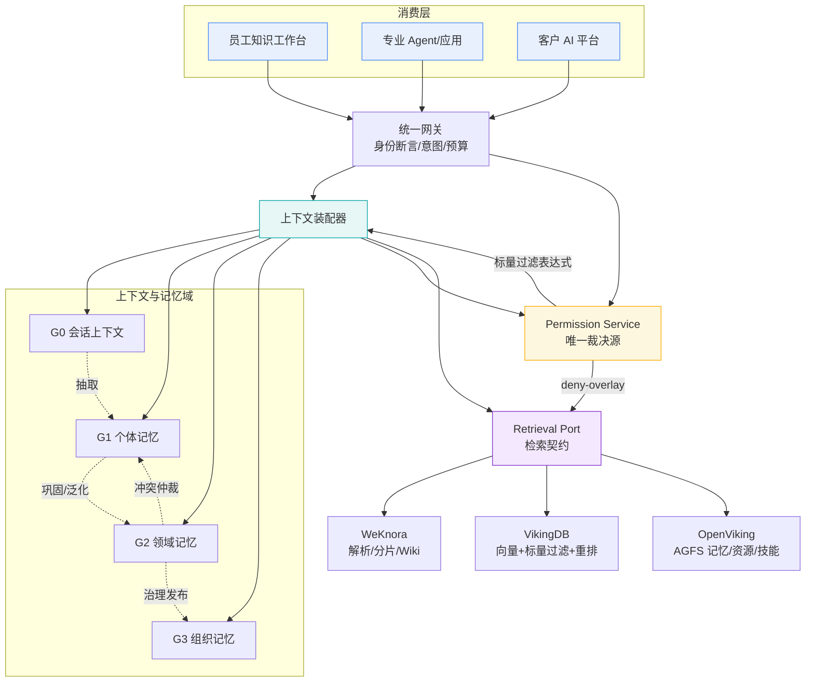

# 企业级多专业 AI 系统共享知识 / 上下文 / 记忆系统 — 实施蓝图

> 版本 v1.0 ｜ 2026-10-20 ｜ 面向工程团队实施蓝图
> 存储检索层：火山引擎 **VikingDB**（托管）/ **OpenViking**（自建上下文库）＋ 腾讯开源 **WeKnora**（文档→分片→Wiki）
> 权限模型：人员 / 岗位（角色）/ 团队 / 部门 四层主体 ＋ 层级外主体（虚拟团队、外部协作方、AI 系统）

---

## 0. 一句话结论

**能建成，但"统一共享记忆"这件事必须被降级为"受治理的、可被单主体撤销的、分层共享的知识与记忆联邦"，而不是一个所有人都能写的公共大脑。** 技术上最硬的约束不在模型或向量库，而在三处可被实证的工程事实：

| # | 事实 | 直接后果 |
| --- | --- | --- |
| 1 | VikingDB **向量索引更新有约 20 秒延迟**（官方口径），标量过滤与向量检索在索引侧完成 | 权限**撤销不可能做到索引级瞬时生效**；必须加应用层二次过滤，否则撤权窗口内仍可召回 |
| 2 | WeKnora 组织权限语义是 **`my_permission = min(共享授予权限, 成员在组织内角色, 调用方租户 RBAC 上限)`**（取低，不是取并集） | WeKnora 自身的组织 RBAC **不能**充当企业四层权限中枢；企业必须自建 Permission Service 作为唯一裁决源 |
| 3 | OpenViking 的 **L0/L1/L2 = 摘要 / 概览 / 详情（加载粒度）**，与本方案要用的 L0–L3 = 会话 / 个体 / 领域 / 组织（治理分层）**同名不同义** | 两套分层若共用 L0–L3 命名，实施期必然串味；本方案统一改名为 **G0–G3（治理分层）** 与 **OV0–OV2（加载粒度）** |
| 4 | OpenViking 主项目 **AGPLv3**（`crates/ov_cli` 与 `examples` 为 Apache-2.0），2026-01 才开源 | 独立进程部署（企业内部员工使用）风险可控；**内嵌进闭源商业产品或对外提供服务则触发 AGPL 第 13 条**，须法务前置 |

**方案的核心主张（3 条）**

1. **权限只做一次、且只在一个地方裁决**——自建 Permission Service 产出"标量过滤表达式"，WeKnora/VikingDB/OpenViking 都只做**执行者**，不做裁决者。三方自带的权限语义一律降级为"共享区内部第二道闸门"。
2. **记忆与知识分账**：知识（慢变、可验证、随版本失效）与记忆（快变、上下文相关、按可信度衰减）用**两套权限、两套失效、两套可信度**；只有经治理审批的"记忆知识化"通道能让记忆继承知识的权限待遇。
3. **共享的最小可撤单元是"分片 + 记忆条目"，不是向量、不是全文段**。向量级不可行（embedding 不可分离），全文段级过粗（敏感段落整块泄漏），因此用**三层防线**：写入期 ACL 固化 → 索引期标量下推 → 召回期 deny-overlay 二次过滤 + 上下文组装期主体纯度校验。

---

## 1. 证据等级约定

全文所有能力声明按下列等级标注，**厂商自报数据一律标 [D]**，不得当作验收依据：

| 等级 | 含义 | 典型来源 |
| --- | --- | --- |
| **[A]** | 一手官方文档 / 官方仓库 / 论文 | 火山引擎官方文档、`github.com/volcengine/OpenViking`、`github.com/Tencent/WeKnora`、arXiv |
| **[B]** | 官方社区文章 / 官方运营文章（含 AI 生成的实践指南） | `volcengine.com/article/*`、`volcengine.com/docs/*` 运营栏目 |
| **[C]** | 第三方源码分析文章（需以仓库源码复核） | CSDN / 技术博客对 WeKnora 内部实现的拆解 |
| **[D]** | 厂商自报基准数据，**未经第三方复现** | `blog.openviking.ai` 基准报告、厂商宣传稿 |

**关键来源清单**

| 主题 | 来源 | 等级 | 用于 |
| --- | --- | --- | --- |
| VikingDB 标量过滤（混合检索） | https://www.volcengine.com/docs/84313/1254590 | [A] | 过滤条件语义、AND/OR 组合 |
| VikingDB 向量检索 / SQL / 过滤下推 | https://www.volcengine.com/docs/84313/1254609 | [A] | `WHERE` + 向量混合、单查询上限 5000 |
| VikingDB 分布式部署与索引参数 | https://www.volcengine.com/article/2763835 | [B] | 分片上限 2000 万条/768 维、HNSW/IVFFLAT 取舍、SLA≥99.9% |
| VikingDB 索引更新延迟 ≈20s、标量索引提速 | 火山引擎知识库运营文章 | [B] | 撤权窗口、标量索引必要性 |
| VikingDB Python SDK | `volcengine` Python SDK v2（Apache-2.0，SDK 层） | [A] | 客户端许可（注意：**仅 SDK**，数据库本体为托管服务） |
| OpenViking 仓库 / 许可 | https://github.com/volcengine/OpenViking | [A] | AGPLv3 主项目；`crates/ov_cli`、`examples` 为 Apache-2.0 |
| OpenViking 官方文档 | https://docs.openviking.ai （中/英/日） | [A] | AGFS、`viking://` URI、`find()`/`search()`、L0/L1/L2 侧车文件 |
| OpenViking 基准（LoCoMo / tau2-bench） | https://blog.openviking.ai/ | **[D] 厂商数据** | 记忆准确率 24–57%→80–83%；输入 Token ↓34.3–91.0%；查询延迟 ↓58.45–66.10% |
| VikingMem 论文 | arXiv:2605.29640（VLDB 2026） | [A] | 记忆层级化与巩固机制的学术依据 |
| WeKnora 仓库 / 许可 | https://github.com/Tencent/WeKnora | [A] | MIT 许可、模块化架构、anydoc 解析、Wiki 模式 |
| WeKnora 组织/租户/权限模型 | 第三方源码分析文章（`internal/types/organization.go` 拆解） | **[C] 待源码复核** | `my_permission = min(...)` 取低语义、`organization_tenant_members`、`kb_shares` |

> ⚠️ 二手渠道对 **OpenViking 基准口径存在分歧**：官方 README 与开发者社区转述的 tau2-bench 数字不完全一致（"任务完成率 +43–49% / Token 成本 ↓83–96%" vs README 表述）。**验收时一律以 `blog.openviking.ai` 报告 + 仓库 `benchmark/` 复现脚本为准，不得引用转述数字。**

---

## 2. 总体架构（文字化层级，无图也能读懂）

**一句话**：四层职责——**主权层**（谁能看什么，唯一裁决）→ **加工层**（文档→分片→知识）→ **上下文层**（会话/个体/领域/组织记忆的进化）→ **执行层**（检索下推、上下文装配、注入）。四层之间用**统一 Chunk Schema + ID/血缘**做唯一契约，内容不双写。

**层级展开（自上而下）**

```
┌─ L4 消费层 ────────────────────────────────────────────────────────┐
│ 员工知识工作台 │ 专业 Agent 与应用 │ 客户 AI 平台 │ 企业业务系统 │ 外部 AI 平台 │
└───────────────────────────┬──────────────────────────────────────────┘
                            │ 统一网关：身份断言 + 意图识别 + 预算分配
┌─ L3 上下文服务层（本方案核心） ────────────────────────────────────┐
│ 上下文装配器 │ 记忆抽取 │ 记忆巩固 │ 冲突仲裁 │ 失效淘汰 │ 血缘与版本 │
│ L0 会话上下文(临时) │ L1 个体记忆(持久) │ L2 领域记忆(域内) │ L3 组织记忆(全 org) │
└───────────────────────────┬──────────────────────────────────────────┘
                            │ 检索契约（Retrieval Port 抽象接口）
┌─ L2 权限主权层 ────────────────────────────────────────────────────┐
│ Permission Service：主体目录 │ 授权图谱 │ 裁决引擎 │ deny-overlay 缓存 │
│ 输出：标量过滤表达式 + 列级 ACL + 上下文主体纯度约束                │
└───────────────────────────┬──────────────────────────────────────────┘
                            │ 同一套过滤表达式下推
┌─ L1 存储检索层 ────────────────────────────────────────────────────┐
│  WeKnora(自建)              │  VikingDB(托管)          │ OpenViking(自建/托管) │
│  文档解析→分片→Wiki         │  向量索引+标量过滤+重排    │ AGFS 记忆/资源/技能     │
│  知识库/组织/版本快照        │  集合-索引-分区键         │ viking:// + memory_diff │
└───────────────────────────────────────────────────────────────────┘
                            │
┌─ L0 技术底座 ─────────────────────────────────────────────────────┐
│ 解析模型与 Embedding │ Rerank │ 任务调度 │ 监控审计 │ 身份集成(IAM/SSO) │
└───────────────────────────────────────────────────────────────────┘
```

**归属映射（对齐既有架构图）**：附件《四大功能层与两类贯穿支撑》中的「知识生产 / 知识资产与管理 / 知识服务 / 知识应用」四层，在本方案中**不按功能切分存储**，而是**按权限切分存储**——这是与原图最重要的偏离，理由见第 1 章 §2.4「为什么不沿用四功能层做存储切分」。

**Mermaid 视图**



---

## 3. 章节导航

| 文档 | 内容 | 篇幅占比 |
| --- | --- | --- |
| [01-权限模型.md](./01-权限模型.md) | 四层主体实体、继承/覆盖规则、隔离区与共享区、行/列级隔离、权限矩阵、求值伪代码 | ~20% |
| [02-上下文与记忆共享.md](./02-上下文与记忆共享.md) | 知识/记忆切分、G0–G3 四层、抽取→巩固→仲裁→淘汰→血缘→度量；**数据模型、抽取/仲裁/注入契约、端到端轨迹、投毒防御、反模式库、集成契约、容量成本模型** | **40%** |
| [03-存储检索与关键流程.md](./03-存储检索与关键流程.md) | VikingDB/OpenViking × WeKnora 能力边界、分工契约、三条数据流、四条关键时序 | ~12% |
| [04-风险取舍与度量.md](./04-风险取舍与度量.md) | 性能/成本/一致性三维风险表、度量体系、阶段化路线与退出点 | ~9% |
| [05-苏格拉底式反思.md](./05-苏格拉底式反思.md) | 六维递进追问（前提→概念→证据→对立→后果→边界）18 问 + 修订台账 + 待验证假设登记表 | ~19% |

### 02 章内部导航（篇幅最重，建议按此顺序读）

| 小节 | 内容 | 何时读 |
| --- | --- | --- |
| §2.0 | 命名冲突消歧（G0–G3 vs OV0–OV2） | **先读**，否则后文会串味 |
| §2.1–§2.2 | 知识/记忆切分、四层记忆 | 理解分层与权限基准 |
| §2.3 | 进化机制（抽取/巩固/仲裁/淘汰/版本血缘/度量） | 核心机制 |
| §2.4–§2.5 | 读写权限与并发、可追溯性四层 | 工程落地 |
| §2.6–§2.9 | **数据模型、抽取契约、仲裁契约、注入契约** | 直接写代码的人 |
| §2.10 | 端到端样例（一个会话从 G0 走到 G3） | 理解机制如何串起来 |
| §2.11–§2.12 | 多 Agent 协作协议、容量与成本模型 | 做容量规划 |
| §2.13 | 替代方案与代价汇总 | 做决策评审 |
| §2.14 | **记忆投毒与对抗**（关键缺口） | 做安全评审 |
| §2.15 | 记忆反模式库（Runbook） | 值班/排障 |
| §2.16–§2.18 | 集成契约、用户面板、格式演进 | 做集成与运维 |
| §2.19–§2.20 | 冷启动、多模态、跨语言、策略灰度 | 上线前 |
| §2.21–§2.24 | 补充替代方案与总汇总 | — |

---

## 4. 关键设计决策台账（含"不这样做的代价"）

> 每一行都是一次真实取舍。**"不这样做的替代方案及其代价"是本蓝图的一部分，不是附录。**

| # | 决策 | 选择 | 替代方案 | 替代方案的代价 |
| --- | --- | --- | --- | --- |
| D1 | 权限裁决位置 | 自建 **Permission Service** 为唯一裁决源，三方只执行 | 直接复用 WeKnora 组织 RBAC | WeKnora 是**取低**语义（`min(共享权限, 组织角色, 租户RBAC)`），无法表达"跨部门取并集 + 显式 deny 优先"；强行用会把企业四层压成"组织内四角色" |
| D2 | ACL 在向量库中的物化 | **主体反范式化**：一行一主体（`acl_subject` 标量列）+ 按行过滤 | 集合/数组字段单行存多主体 | 官方过滤条件为"包含/不包含/大于/小于/≥/≤"六种 [A]，**数组字段上的多值"包含"语义与索引行为无一手文档背书**；反范式化可确保命中确定，且召回后天然可去重 |
| D3 | 撤权生效路径 | **索引期下推 + 召回期 deny-overlay 二次过滤** | 只靠索引侧过滤 / 靠 TTL 等待索引刷新 | VikingDB 向量索引更新约 20 秒延迟 [B] → 纯索引侧撤权存在**最长约 20 秒的越权召回窗口**；且 deny 撤销无法靠删除行解决（删除同样有索引延迟） |
| D4 | 记忆分层命名 | 治理分层用 **G0–G3**，OpenViking 加载粒度用 **OV0–OV2** | 沿用 L0–L3 / L0–L2 | 两套 L 命名在 OpenViking 语境下高频共现，混用后"记忆分层"与"加载分层"在工单、配置、日志里必然串味 |
| D5 | 记忆能否直接变知识 | 必须走**治理审批的"记忆知识化"晋升通道**，继承知识的权限与失效待遇 | 记忆自动晋升为知识 | 自动晋升会把"个人偏好/一次会话结论"洗成"组织权威知识"，且错误的组织级知识会随版本制度长期存活——**熵增从个人层转移到全组织层** |
| D6 | 跨主体共享方式 | **引用非复制**（记忆条目携带 `subject_ref` + 运行时授权解析） | 复制内容到对方命名空间 | 复制产生多份真相、撤销时漏删、审计链断裂；复制件若不携带原权限，撤权后副本仍在 |
| D7 | 冲突仲裁默认动作 | 分数差 < 阈值 → **双记并查**（并存 + 标注分歧）；超阈值 → 人工队列 | 一律"新覆盖旧" | 一律覆盖会让"最新但错误"的结论瞬间污染共享层；一律人工则仲裁队列爆炸 |
| D8 | 遗忘方式 | **分级降层 + 归档 + Tombstone**，不物理删除 | TTL 到期直接删 / 永不删 | 物理删除无法审计与回滚（用户"被遗忘权"与"错误遗忘"诉求冲突）；永不删则熵增，检索噪声压垮召回质量 |
| D9 | OpenViking 交付形态 | **独立进程自建**（企业内网，仅员工/内部 AI 系统访问），法务前置确认 AGPL 第 13 条适用边界 | 内嵌进闭源商业产品 / 直接用商业托管 | 内嵌+对外提供服务触发 AGPL 源码开放义务；托管则记忆数据出域（个人偏好与对话内容通常是最敏感数据） |
| D10 | 存储唯一契约 | **统一 Chunk Schema**，以 `chunk_id` + 血缘关联三方，**内容只写一处** | WeKnora 与 VikingDB 各存一份正文 | 双写必然出现"Wiki 里改了、向量里没改"的漂移，且撤销/更新要改两处，两处不同步即产生越权副本 |
| D11 | 知识加工链路 | WeKnora 负责**文档→分片→Wiki**；分片向量写入 VikingDB 由**中台侧适配器**发起 | 用 WeKnora 自带向量库 | WeKnora 检索层自带向量存储，ACL 下推能力弱于 VikingDB 的原生标量过滤；强行只在 WeKnora 内做 ACL 会退化为"检索后裁剪"（见 §1.5.1 反模式） |
| D12 | 组织记忆写入主体 | **治理委员会 + 域主双签**，不设"全员可写" | 开放全员写入 | 全员可写 ⇒ 记忆库变成意见广场，命中率与可信度同步崩塌，且噪声不可逆（需要人工逐条清理） |
| D13 | 授权上浮 | 越级授权（跨部门）**需审批 + 记录 approver + 强制 TTL** | 直接继承/直接授予 | 无 TTL 的越级授权会沉淀为"事实上的永久白名单"，权限漂移不可逆 |
| D14 | 检索可见性 | 全部检索返回**召回轨迹 + 引用定位 + 血缘链** | 只返回答案 | 无轨迹则"为什么召回这条"不可归因，错误记忆无法定位，冲突仲裁缺输入——**治理闭环缺少最关键的一环** |

---

## 5. 与附件三张架构图的对应关系

| 附件图 | 图中模块 | 本方案落点 | 变更说明 |
| --- | --- | --- | --- |
| 图1 总体架构 | 知识来源/知识建设/知识管理/知识服务/知识使用 | 消费层 + 加工层 + 权限主权层 + 存储层 | **新增"权限主权层"**，因为原图未体现四层主体权限如何在多 AI 系统间裁决 |
| 图1 | 企业共享知识 / 个人知识 / 运行记忆 | **知识域** / **G1 记忆域** / **G0+G2+G3 记忆域** | 原图三类 → 本方案按**权限强度与生命周期**拆为 1 知识 + 4 记忆层（见 §2.2） |
| 图2 四大功能层 | 01 知识生产 → 04 知识应用 | 加工层 → 消费层 | 功能层**保留为流程视图**，但不作为存储/权限的切分轴（见 §1.4） |
| 图2 | 治理与运营（使用与贡献/调用与效果/权属与生命周期/接入与发布） | **独立治理面**（贯穿四层） | 保留原图的"权属与生命周期"→ 直接映射到本方案 §2.3 覆盖规则与 §3 失效淘汰 |
| 图3 知识回流 | 01 来源变化 / 02 工作成果 / 03 使用反馈 | **记忆抽取（E）/ 巩固（C）/ 晋升（L3 发布）** | 原图三条回流线 **全部是记忆进化的输入**；本方案为其补上冲突仲裁、版本血缘、淘汰与指标反哺 |
| 图3 | "员工主动提交成果，个人资料与原始记忆继续按所属范围管理" | **G1→G2→G3 的引用非复制晋升路径** | 原图底部紫线是"范围不变"原则，本方案把它落成 `subject_ref` 不变 + 授权解析在运行时执行 |

---

## 6. 落地顺序建议（分阶段，详见 04 章）

| 阶段 | 周期 | 交付 | 退出点（判据） |
| --- | --- | --- | --- |
| P0 单域试点 | 4–6 周 | **仅一个 AI 系统 + 一个部门**；WeKnora 做分片/VikingDB 做检索；权限先用「部门 + 岗位」两层，**不做四层**；**不做 G2/G3**；**必须含无记忆降级路径** | 该域知识命中率未提升、治理人力不可持续，或**断开记忆库后系统崩溃** ⇒ 回到 P0 缩小范围，**不要进入 P1** |
| P1 四层权限 + G1 | 8–10 周 | Permission Service 上线、四层主体、召回期 deny-overlay、G1 个体记忆闭环、**用户可见的记忆面板** | 撤权延迟 p99 < 5s 且红队越权用例 0 通过；**制度门禁 8 项齐备** |
| P2 G2 领域记忆 | 8–10 周 | 跨系统共享记忆、冲突仲裁、人工仲裁队列、语境契约与本体对齐、指标反哺 | 冲突自动仲裁率与回滚频次达标，至少一个域完成过一次"记忆→知识"治理晋升；**域主+备份双岗到位** |
| P3 G3 组织记忆 + 知识回流闭环 | 持续 | 治理委员会机制、知识回流三线、审计与红队常态化 | 组织级记忆错误率 < 1%，且具备**单域下线能力**（演练过） |
